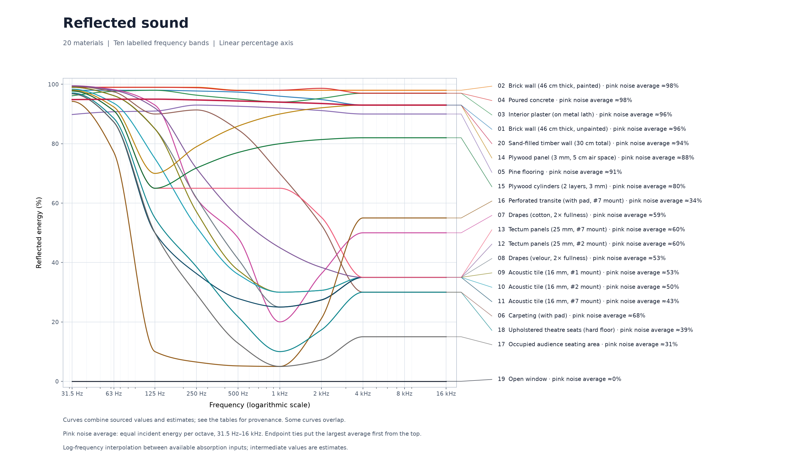
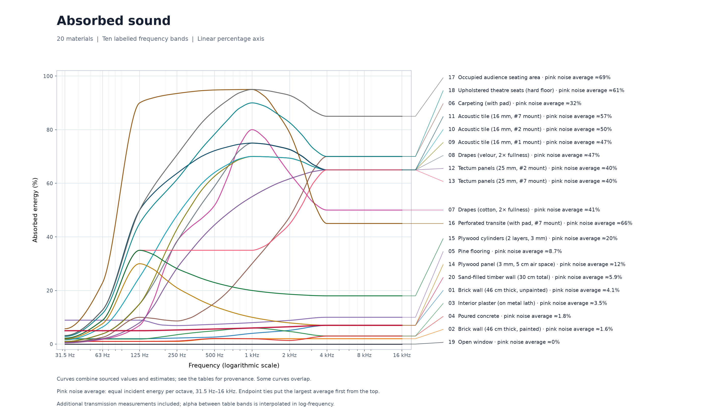
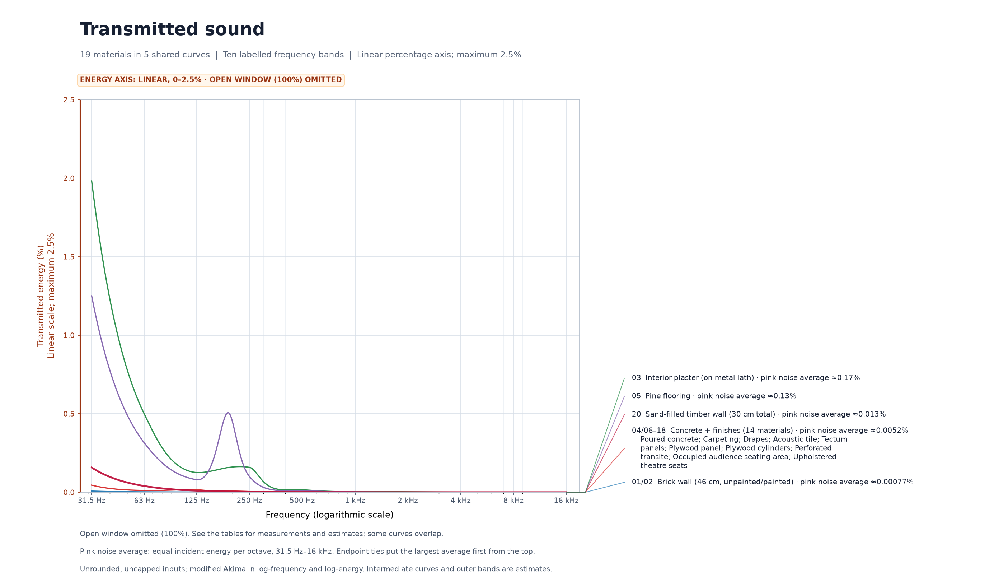
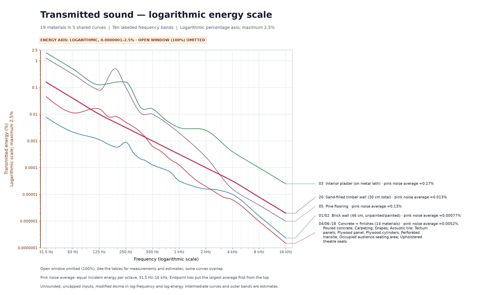

<!-- Generated by scripts/acoustics/split.py from acoustics.template.md and data.py next to it. Edit those and regenerate, see README.md. -->

# SdWa5 — Acoustics

How much of the sound that hits a wall, a floor or a curtain comes back into the room, how much the material
swallows, and how much gets through to the other side. The tables below rebuild Table 6-1 of the *Sound
Reinforcement Handbook* with that three-way split, and they add an open window and a sand-filled timber wall.
They cover the ten ISO 266 octave bands from 31.5 Hz to 16 kHz, which together span about 22 Hz to 22 kHz.

## Reflected, absorbed and through

When sound hits a boundary, part of its energy is reflected, part is turned into heat inside the material, and the
rest passes through into the room or the open air behind it. The handbook describes this split on p. 53, but its
table gives a single number per material, the absorption coefficient α. That α counts everything that does not come
back, whether it was absorbed or passed through. Sabine's open window is the textbook case, because it has α = 1
although it absorbs nothing.

The three shares follow per frequency from α and from the sound reduction index R of the construction in dB.

- **Reflected** = 1 − α, straight from the handbook.
- **Through** = 10^(−R/10). A wall with R = 50 dB lets 10⁻⁵ of the energy through, which is −50 dB or 0.001 %.
- **Absorbed** = α − through.

Through means through the whole construction as built, into the space behind it. A curtain in front of a concrete
wall lets most of the sound through its fabric, but the concrete sends it back, and the handbook's α already contains
that. The curtain row therefore shows what gets through the concrete.

The three shares add up to 100 %. The tables round them, so a row can miss 100 % slightly.

## Graphs

Each graph uses solid curves without point markers, with material names beside their right-hand endpoints.
Coloured leader lines connect the names to the curves; labels are spread apart where they would collide.
Labels follow endpoint height. Endpoints within one pixel of the exported image share a height group, ordered
by pink noise average from largest to smallest, top to bottom. Original material order breaks a remaining tie.
Identical complete curves share one labelled block: both brick finishes share a transmission curve, and the
thirteen concrete-backed finish and seating rows share another with poured concrete. Both transmission graphs therefore show five
distinct curves for nineteen materials. Reflection and absorption each have twenty distinct curves.
Merged curves use the colour of their first material; the labels retain all represented material numbers.
The frequency axis is logarithmic and keeps the ten octave-band labels used by the tables. Reflected and
absorbed graphs include all 20 materials on linear 0–100 % axes. Both transmitted graphs omit the open window,
whose 100 % transmission would hide the much smaller wall fractions; it remains in every table and in the
reflected and absorbed graphs. The other 19 materials reach at most about 1.98 % plotted transmission, so the
transmitted graphs use a linear 0–2.5 % axis and a logarithmic 0.0000001–2.5 % axis. An amber notice and highlighted
vertical-axis labels call out the limited range and scale. The captions identify the omitted window, and the axis labels state the 2.5 %
upper limit. The title “Transmitted sound — logarithmic energy scale” names the graph whose energy-percentage
axis is logarithmic; its frequency axis is logarithmic too, as in the other three graphs.

The curves use the unrounded energy inputs at the ten table frequencies. Transmission and absorbed curves also use the
[additional source frequencies](#additional-transmission-inputs-for-the-graphs)
below. Reflected curves retain the ten α inputs, because the retained sources provide no finer absorption
measurements for these specimens. Reflection and absorption use shape-preserving cubic interpolation (PCHIP)
in logarithmic frequency. Transmission uses modified Akima interpolation in logarithmic frequency and energy
to avoid flat runs between equal reported readings while retaining every input. These interpolated curves
are estimates between the inputs. The tables and source descriptions identify
which inputs are measurements and which are estimates. Some curves overlap where their values are identical.

The **pink noise average** beside each name is the mean plotted energy percentage for a pink-noise reference with equal
incident energy per octave, over 31.5 Hz–16 kHz. For plotted percentage E(f), it is
∫ E(f) d ln(f) / ln(16000/31.5), evaluated across the dense curve. Pink noise supplies the equal-energy-per-octave
reference ([Rational Acoustics](https://support.rationalacoustics.com/support/solutions/articles/150000189769-why-is-my-noise-pink-noise-contours-explained)).
Energy percentages are averaged directly, including on the logarithmic-energy plot, so the two transmission
views show the same averages. This summarizes the unrounded, uncapped plotted model, including
the estimated outer bands. A particular music or noise spectrum can give a different energy average.

Each graph has one plot, and its subtitle names its material count and percentage axis.
Reflected and absorbed curves use unrounded energy shares. At the additional transmission frequencies,
absorbed = interpolated α − through; these points add transmission evidence, not absorption measurements.
Transmitted curves also use unrounded, uncapped inputs and interpolate logarithmic percentages. Equal source
readings constrain two endpoints without establishing a perfectly flat response between them; modified Akima
interpolation avoids the stairs that PCHIP would draw there. Rounding
estimates to 5 dB before interpolation would create artificial stairs and make identical concrete constructions
look different. The Through tables retain their rounding and ≤ −80 dB† / ≤ 0.000001 %† display convention;
the curves retain the underlying values. This changes presentation, not the accuracy of the estimates.

## Tables

At 125 Hz, 1 kHz and 4 kHz, the first 18 rows take α from the handbook (Davis & Jones 1989, Table 6-1, p. 54),
in its order, with dimensions converted to metric. Its mounts are #1 cemented directly to plaster or concrete,
#2 fastened to nominal 25 mm furring strips and #7 a suspended ceiling with 41 cm of air space above.
Transite was an asbestos-cement board.
Material and thickness occupy separate columns. A dash means that the material's thickness was not specified
or does not apply. Dimensions of the assumed backing constructions remain in the Assumptions below.
The open window and the sand-filled timber wall are added rows; their values come from the [Assumptions](#assumptions).
The other seven columns come from measurements of the construction where they exist, and otherwise from a
measured comparable specimen, a model or interpolation, see [How the added frequencies are
estimated](#how-the-added-frequencies-are-estimated). Every value that is not a measurement of the construction
itself is an estimate (†). The handbook's own values at 125 Hz, 1 kHz and 4 kHz remain unchanged.

### Reflected

| Material | Thickness | 31.5 Hz | 63 Hz | 125 Hz | 250 Hz | 500 Hz | 1 kHz | 2 kHz | 4 kHz | 8 kHz | 16 kHz |
|---|---:|---:|---:|---:|---:|---:|---:|---:|---:|---:|---:|
| Brick wall (unpainted) | 46 cm | 98 %† | 98 %† | 98 % | 98 %† | 97 %† | 96 % | 95 %† | 93 % | 93 %† | 93 %† |
| Brick wall (painted) | 46 cm | 99 %† | 99 %† | 99 % | 99 %† | 98 %† | 98 % | 98 %† | 98 % | 98 %† | 98 %† |
| Interior plaster (on metal lath) | — | 96 %† | 98 %† | 98 % | 96 %† | 95 %† | 94 % | 95 %† | 97 % | 97 %† | 97 %† |
| Poured concrete | — | 99 %† | 99 %† | 99 % | 99 %† | 98 %† | 98 % | 99 %† | 97 % | 97 %† | 97 %† |
| Pine flooring | — | 90 %† | 91 %† | 91 % | 93 %† | 93 %† | 92 % | 91 %† | 90 % | 90 %† | 90 %† |
| Carpeting (with pad) | — | 99 %† | 97 %† | 90 % | 91 %† | 85 %† | 70 % | 53 %† | 30 % | 30 %† | 30 %† |
| Drapes (cotton, 2× fullness) | — | 100 %† | 98 %† | 93 % | 62 %† | 48 %† | 20 % | 36 %† | 50 % | 50 %† | 50 %† |
| Drapes (velour, 2× fullness) | — | 99 %† | 96 %† | 85 % | 62 %† | 41 %† | 25 % | 27 %† | 35 % | 35 %† | 35 %† |
| Acoustic tile (#1 mount\*) | 16 mm | 99 %† | 96 %† | 85 % | 57 %† | 37 %† | 30 % | 31 %† | 35 % | 35 %† | 35 %† |
| Acoustic tile (#2 mount\*) | 16 mm | 98 %† | 94 %† | 75 % | 52 %† | 36 %† | 30 % | 31 %† | 35 % | 35 %† | 35 %† |
| Acoustic tile (#7 mount\*) | 16 mm | 97 %† | 87 %† | 50 % | 36 %† | 28 %† | 25 % | 27 %† | 35 % | 35 %† | 35 %† |
| Tectum panels (#2 mount\*) | 25 mm | 99 %† | 98 %† | 92 % | 72 %† | 56 %† | 45 % | 38 %† | 35 % | 35 %† | 35 %† |
| Tectum panels (#7 mount\*) | 25 mm | 98 %† | 91 %† | 65 % | 65 %† | 65 %† | 65 % | 55 %† | 35 % | 35 %† | 35 %† |
| Plywood panel (5 cm air space) | 3 mm | 98 %† | 92 %† | 70 % | 79 %† | 86 %† | 90 % | 92 %† | 93 % | 93 %† | 93 %† |
| Plywood cylinders (2 layers) | 3 mm | 98 %† | 91 %† | 65 % | 72 %† | 77 %† | 80 % | 81 %† | 82 % | 82 %† | 82 %† |
| Perforated transite (with pad, #7 mount\*) | — | 94 %† | 77 %† | 10 % | 6 %† | 5 %† | 5 % | 21 %† | 55 % | 55 %† | 55 %† |
| Occupied audience seating area | — | 97 %† | 87 %† | 50 % | 29 %† | 13 %† | 5 % | 7 %† | 15 % | 15 %† | 15 %† |
| Upholstered theatre seats (hard floor) | — | 97 %† | 89 %† | 55 % | 39 %† | 22 %† | 10 % | 17 %† | 30 % | 30 %† | 30 %† |
| Open window | — | 0 % | 0 % | 0 % | 0 % | 0 % | 0 % | 0 % | 0 % | 0 % | 0 % |
| Sand-filled timber wall | 30 cm total | 95 %† | 95 %† | 95 %† | 95 %† | 94 %† | 94 %† | 94 %† | 93 %† | 93 %† | 93 %† |

Reflected = 100 % − α. † estimated, see [Assumptions](#assumptions).

### Absorbed

| Material | Thickness | 31.5 Hz | 63 Hz | 125 Hz | 250 Hz | 500 Hz | 1 kHz | 2 kHz | 4 kHz | 8 kHz | 16 kHz |
|---|---:|---:|---:|---:|---:|---:|---:|---:|---:|---:|---:|
| Brick wall (unpainted) | 46 cm | 2 %† | 2 %† | 2 % | 2 %† | 3 %† | 4 % | 5 %† | 7 % | 7 %† | 7 %† |
| Brick wall (painted) | 46 cm | 1 %† | 1 %† | 1 % | 1 %† | 2 %† | 2 % | 2 %† | 2 % | 2 %† | 2 %† |
| Interior plaster (on metal lath) | — | 2 %† | 2 %† | 2 % | 3 %† | 5 %† | 6 % | 5 %† | 3 % | 3 %† | 3 %† |
| Poured concrete | — | 1 %† | 1 %† | 1 % | 1 %† | 2 %† | 2 % | 1 %† | 3 % | 3 %† | 3 %† |
| Pine flooring | — | 9 %† | 9 %† | 9 % | 7 %† | 7 %† | 8 % | 9 %† | 10 % | 10 %† | 10 %† |
| Carpeting (with pad) | — | 1 %† | 3 %† | 10 % | 9 %† | 15 %† | 30 % | 47 %† | 70 % | 70 %† | 70 %† |
| Drapes (cotton, 2× fullness) | — | 0 %† | 2 %† | 7 % | 38 %† | 52 %† | 80 % | 64 %† | 50 % | 50 %† | 50 %† |
| Drapes (velour, 2× fullness) | — | 1 %† | 4 %† | 15 % | 38 %† | 59 %† | 75 % | 73 %† | 65 % | 65 %† | 65 %† |
| Acoustic tile (#1 mount\*) | 16 mm | 1 %† | 4 %† | 15 % | 43 %† | 63 %† | 70 % | 69 %† | 65 % | 65 %† | 65 %† |
| Acoustic tile (#2 mount\*) | 16 mm | 2 %† | 6 %† | 25 % | 48 %† | 64 %† | 70 % | 69 %† | 65 % | 65 %† | 65 %† |
| Acoustic tile (#7 mount\*) | 16 mm | 3 %† | 13 %† | 50 % | 64 %† | 72 %† | 75 % | 73 %† | 65 % | 65 %† | 65 %† |
| Tectum panels (#2 mount\*) | 25 mm | 1 %† | 2 %† | 8 % | 28 %† | 44 %† | 55 % | 62 %† | 65 % | 65 %† | 65 %† |
| Tectum panels (#7 mount\*) | 25 mm | 2 %† | 9 %† | 35 % | 35 %† | 35 %† | 35 % | 45 %† | 65 % | 65 %† | 65 %† |
| Plywood panel (5 cm air space) | 3 mm | 2 %† | 8 %† | 30 % | 21 %† | 14 %† | 10 % | 8 %† | 7 % | 7 %† | 7 %† |
| Plywood cylinders (2 layers) | 3 mm | 2 %† | 9 %† | 35 % | 28 %† | 23 %† | 20 % | 19 %† | 18 % | 18 %† | 18 %† |
| Perforated transite (with pad, #7 mount\*) | — | 6 %† | 23 %† | 90 % | 94 %† | 95 %† | 95 % | 79 %† | 45 % | 45 %† | 45 %† |
| Occupied audience seating area | — | 3 %† | 13 %† | 50 % | 71 %† | 87 %† | 95 % | 93 %† | 85 % | 85 %† | 85 %† |
| Upholstered theatre seats (hard floor) | — | 3 %† | 11 %† | 45 % | 61 %† | 78 %† | 90 % | 83 %† | 70 % | 70 %† | 70 %† |
| Open window | — | 0 % | 0 % | 0 % | 0 % | 0 % | 0 % | 0 % | 0 % | 0 % | 0 % |
| Sand-filled timber wall | 30 cm total | 5 %† | 5 %† | 5 %† | 5 %† | 6 %† | 6 %† | 6 %† | 7 %† | 7 %† | 7 %† |

Absorbed = α − through. † estimated, see [Assumptions](#assumptions).

### Through, in dB

| Material | Thickness | 31.5 Hz | 63 Hz | 125 Hz | 250 Hz | 500 Hz | 1 kHz | 2 kHz | 4 kHz | 8 kHz | 16 kHz |
|---|---:|---:|---:|---:|---:|---:|---:|---:|---:|---:|---:|
| Brick wall (unpainted) | 46 cm | −40 dB† | −45 dB† | −50 dB† | −50 dB† | −60 dB† | −65 dB† | −70 dB† | −70 dB† | ≤ −80 dB† | ≤ −80 dB† |
| Brick wall (painted) | 46 cm | −40 dB† | −45 dB† | −50 dB† | −50 dB† | −60 dB† | −65 dB† | −70 dB† | −70 dB† | ≤ −80 dB† | ≤ −80 dB† |
| Interior plaster (on metal lath) | — | −15 dB† | −25 dB† | −29 dB | −28 dB | −38 dB | −45 dB | −46 dB | −54 dB | −60 dB† | −65 dB† |
| Poured concrete | — | −35 dB† | −40 dB† | −38 dB | −43 dB | −52 dB | −59 dB | −67 dB | −72 dB | ≤ −80 dB† | ≤ −80 dB† |
| Pine flooring | — | −20 dB† | −25 dB† | −31 dB | −30 dB | −40 dB | −47 dB | −56 dB | −68 dB | −75 dB† | ≤ −80 dB† |
| Carpeting (with pad) | — | −35 dB† | −40 dB† | −40 dB† | −45 dB† | −50 dB† | −60 dB† | −65 dB† | −70 dB† | ≤ −80 dB† | ≤ −80 dB† |
| Drapes (cotton, 2× fullness) | — | −35 dB† | −40 dB† | −40 dB† | −45 dB† | −50 dB† | −60 dB† | −65 dB† | −70 dB† | ≤ −80 dB† | ≤ −80 dB† |
| Drapes (velour, 2× fullness) | — | −35 dB† | −40 dB† | −40 dB† | −45 dB† | −50 dB† | −60 dB† | −65 dB† | −70 dB† | ≤ −80 dB† | ≤ −80 dB† |
| Acoustic tile (#1 mount\*) | 16 mm | −35 dB† | −40 dB† | −40 dB† | −45 dB† | −50 dB† | −60 dB† | −65 dB† | −70 dB† | ≤ −80 dB† | ≤ −80 dB† |
| Acoustic tile (#2 mount\*) | 16 mm | −35 dB† | −40 dB† | −40 dB† | −45 dB† | −50 dB† | −60 dB† | −65 dB† | −70 dB† | ≤ −80 dB† | ≤ −80 dB† |
| Acoustic tile (#7 mount\*) | 16 mm | −35 dB† | −40 dB† | −40 dB† | −45 dB† | −50 dB† | −60 dB† | −65 dB† | −70 dB† | ≤ −80 dB† | ≤ −80 dB† |
| Tectum panels (#2 mount\*) | 25 mm | −35 dB† | −40 dB† | −40 dB† | −45 dB† | −50 dB† | −60 dB† | −65 dB† | −70 dB† | ≤ −80 dB† | ≤ −80 dB† |
| Tectum panels (#7 mount\*) | 25 mm | −35 dB† | −40 dB† | −40 dB† | −45 dB† | −50 dB† | −60 dB† | −65 dB† | −70 dB† | ≤ −80 dB† | ≤ −80 dB† |
| Plywood panel (5 cm air space) | 3 mm | −35 dB† | −40 dB† | −40 dB† | −45 dB† | −50 dB† | −60 dB† | −65 dB† | −70 dB† | ≤ −80 dB† | ≤ −80 dB† |
| Plywood cylinders (2 layers) | 3 mm | −35 dB† | −40 dB† | −40 dB† | −45 dB† | −50 dB† | −60 dB† | −65 dB† | −70 dB† | ≤ −80 dB† | ≤ −80 dB† |
| Perforated transite (with pad, #7 mount\*) | — | −35 dB† | −40 dB† | −40 dB† | −45 dB† | −50 dB† | −60 dB† | −65 dB† | −70 dB† | ≤ −80 dB† | ≤ −80 dB† |
| Occupied audience seating area | — | −35 dB† | −40 dB† | −40 dB† | −45 dB† | −50 dB† | −60 dB† | −65 dB† | −70 dB† | ≤ −80 dB† | ≤ −80 dB† |
| Upholstered theatre seats (hard floor) | — | −35 dB† | −40 dB† | −40 dB† | −45 dB† | −50 dB† | −60 dB† | −65 dB† | −70 dB† | ≤ −80 dB† | ≤ −80 dB† |
| Open window | — | 0 dB | 0 dB | 0 dB | 0 dB | 0 dB | 0 dB | 0 dB | 0 dB | 0 dB | 0 dB |
| Sand-filled timber wall | 30 cm total | −30 dB† | −35 dB† | −40 dB† | −45 dB† | −50 dB† | −55 dB† | −60 dB† | −65 dB† | −70 dB† | −75 dB† |

Level of the sound that gets through, relative to the sound that hits the construction. Measured values are given to 1 dB and estimates (†) to 5 dB. Estimates rounding to 80 dB or more use ≤ −80 dB†, see [Assumptions](#assumptions).

### Through, in %

| Material | Thickness | 31.5 Hz | 63 Hz | 125 Hz | 250 Hz | 500 Hz | 1 kHz | 2 kHz | 4 kHz | 8 kHz | 16 kHz |
|---|---:|---:|---:|---:|---:|---:|---:|---:|---:|---:|---:|
| Brick wall (unpainted) | 46 cm | 0.01 %† | 0.003 %† | 0.001 %† | 0.001 %† | 0.0001 %† | 0.00003 %† | 0.00001 %† | 0.00001 %† | ≤ 0.000001 %† | ≤ 0.000001 %† |
| Brick wall (painted) | 46 cm | 0.01 %† | 0.003 %† | 0.001 %† | 0.001 %† | 0.0001 %† | 0.00003 %† | 0.00001 %† | 0.00001 %† | ≤ 0.000001 %† | ≤ 0.000001 %† |
| Interior plaster (on metal lath) | — | 3 %† | 0.3 %† | 0.1 % | 0.2 % | 0.02 % | 0.003 % | 0.003 % | 0.0004 % | 0.0001 %† | 0.00003 %† |
| Poured concrete | — | 0.03 %† | 0.01 %† | 0.02 % | 0.005 % | 0.0006 % | 0.0001 % | 0.00002 % | 0.000006 % | ≤ 0.000001 %† | ≤ 0.000001 %† |
| Pine flooring | — | 1 %† | 0.3 %† | 0.08 % | 0.1 % | 0.01 % | 0.002 % | 0.0003 % | 0.00002 % | 0.000003 %† | ≤ 0.000001 %† |
| Carpeting (with pad) | — | 0.03 %† | 0.01 %† | 0.01 %† | 0.003 %† | 0.001 %† | 0.0001 %† | 0.00003 %† | 0.00001 %† | ≤ 0.000001 %† | ≤ 0.000001 %† |
| Drapes (cotton, 2× fullness) | — | 0.03 %† | 0.01 %† | 0.01 %† | 0.003 %† | 0.001 %† | 0.0001 %† | 0.00003 %† | 0.00001 %† | ≤ 0.000001 %† | ≤ 0.000001 %† |
| Drapes (velour, 2× fullness) | — | 0.03 %† | 0.01 %† | 0.01 %† | 0.003 %† | 0.001 %† | 0.0001 %† | 0.00003 %† | 0.00001 %† | ≤ 0.000001 %† | ≤ 0.000001 %† |
| Acoustic tile (#1 mount\*) | 16 mm | 0.03 %† | 0.01 %† | 0.01 %† | 0.003 %† | 0.001 %† | 0.0001 %† | 0.00003 %† | 0.00001 %† | ≤ 0.000001 %† | ≤ 0.000001 %† |
| Acoustic tile (#2 mount\*) | 16 mm | 0.03 %† | 0.01 %† | 0.01 %† | 0.003 %† | 0.001 %† | 0.0001 %† | 0.00003 %† | 0.00001 %† | ≤ 0.000001 %† | ≤ 0.000001 %† |
| Acoustic tile (#7 mount\*) | 16 mm | 0.03 %† | 0.01 %† | 0.01 %† | 0.003 %† | 0.001 %† | 0.0001 %† | 0.00003 %† | 0.00001 %† | ≤ 0.000001 %† | ≤ 0.000001 %† |
| Tectum panels (#2 mount\*) | 25 mm | 0.03 %† | 0.01 %† | 0.01 %† | 0.003 %† | 0.001 %† | 0.0001 %† | 0.00003 %† | 0.00001 %† | ≤ 0.000001 %† | ≤ 0.000001 %† |
| Tectum panels (#7 mount\*) | 25 mm | 0.03 %† | 0.01 %† | 0.01 %† | 0.003 %† | 0.001 %† | 0.0001 %† | 0.00003 %† | 0.00001 %† | ≤ 0.000001 %† | ≤ 0.000001 %† |
| Plywood panel (5 cm air space) | 3 mm | 0.03 %† | 0.01 %† | 0.01 %† | 0.003 %† | 0.001 %† | 0.0001 %† | 0.00003 %† | 0.00001 %† | ≤ 0.000001 %† | ≤ 0.000001 %† |
| Plywood cylinders (2 layers) | 3 mm | 0.03 %† | 0.01 %† | 0.01 %† | 0.003 %† | 0.001 %† | 0.0001 %† | 0.00003 %† | 0.00001 %† | ≤ 0.000001 %† | ≤ 0.000001 %† |
| Perforated transite (with pad, #7 mount\*) | — | 0.03 %† | 0.01 %† | 0.01 %† | 0.003 %† | 0.001 %† | 0.0001 %† | 0.00003 %† | 0.00001 %† | ≤ 0.000001 %† | ≤ 0.000001 %† |
| Occupied audience seating area | — | 0.03 %† | 0.01 %† | 0.01 %† | 0.003 %† | 0.001 %† | 0.0001 %† | 0.00003 %† | 0.00001 %† | ≤ 0.000001 %† | ≤ 0.000001 %† |
| Upholstered theatre seats (hard floor) | — | 0.03 %† | 0.01 %† | 0.01 %† | 0.003 %† | 0.001 %† | 0.0001 %† | 0.00003 %† | 0.00001 %† | ≤ 0.000001 %† | ≤ 0.000001 %† |
| Open window | — | 100 % | 100 % | 100 % | 100 % | 100 % | 100 % | 100 % | 100 % | 100 % | 100 % |
| Sand-filled timber wall | 30 cm total | 0.1 %† | 0.03 %† | 0.01 %† | 0.003 %† | 0.001 %† | 0.0003 %† | 0.0001 %† | 0.00003 %† | 0.00001 %† | 0.000003 %† |

The dB values above as a share of the energy, to one significant digit. Every 10 dB less is a tenth of the energy. The display limit ≤ −80 dB† corresponds to ≤ 0.000001 %†. † estimated, see [Assumptions](#assumptions).

## Assumptions

The handbook names materials, not constructions, so every row needs a construction to say what is behind it.
The sourced R values are laboratory values to ASTM E90 or its predecessors; the other R values are estimates
for the stated constructions. Sound that travels around a wall through adjoining
floors and walls reduces its insulation in a building. The tables describe direct transmission through the construction.

| Rows | Construction assumed | Basis |
|---|---|---|
| Brick wall, both rows | Solid brick wall 46 cm, about 870 kg/m², neighbouring room behind | Two lab tests of 30 cm solid brick at 125 Hz / 1 kHz / 4 kHz, 45 / 59 / 61 dB (BMS 144, Table 2, panel 307) and 44 / 61 / 69 dB (BIA 5A, Table 1, TL67-32), and at 250 / 500 / 2000 Hz 44 / 53 / 60 dB and 47 / 55 / 66 dB, plus 5 dB for 1.5 times the mass |
| Interior plaster | Wood-stud partition with expanded-metal lath and 19 mm sanded gypsum plaster on both sides, 88 kg/m², neighbouring room behind | Lab test, BMS 144, Table 2, panel 228, with 256 / 512 / 2048 Hz taken as 250 / 500 / 2000 Hz |
| Poured concrete | Solid concrete wall 150 mm, 366 kg/m², neighbouring room behind | Lab test to ASTM E90, PCI Designer's Notebook *Acoustics*, Fig. 2 and its worked example; 250 / 500 / 2000 Hz read from the graph to about ±1 dB |
| Pine flooring | Timber joist floor with 25 mm pine subfloor and 25 mm pine finish floor, fibreboard and plaster ceiling, 77 kg/m², room below | Lab test, BMS 144, Table 3, panel 708, with 256 / 512 / 2048 Hz taken as 250 / 500 / 2000 Hz |
| Carpeting, drapes, acoustic tile, Tectum panels, plywood panel and cylinders, perforated transite, audience seating, theatre seats | The finish or object in front of or on a 150 mm concrete wall or slab, room on the other side of the concrete. For the #7 mount that is the floor above; sound running through the ceiling void into the next room is not included | The bare concrete wall above, rounded; the finish itself adds a little, which is ignored |
| Open window | An opening, outside behind it | By definition, the reference Sabine used for α = 1 (handbook p. 54) |
| Sand-filled timber wall | Two faces of 25 mm softwood boards with 25 cm of dry sand between them, about 410 kg/m², tight joints, other side of the wall behind it | No measurement of this construction was found. Heavy walls of similar mass measured in the lab: 300 mm rammed earth, 614 kg/m², about 42 / 60 / 66 dB, and 300 mm cob, 536 kg/m², about 39 / 51 / 60 dB (Blinet et al. 2026, Fig. 4a and Fig. 5, read from the graphs), and the 150 mm concrete wall above. Absorbed share from timber fixed directly to a solid backing, such as parquet on concrete at 0.04 / 0.06 / 0.07 and plywood mounted solidly at 0.05 (akustik.ua compilation) |

Sound reduction index R of each construction, the basis of the Through tables.

| Construction | 31.5 Hz | 63 Hz | 125 Hz | 250 Hz | 500 Hz | 1 kHz | 2 kHz | 4 kHz | 8 kHz | 16 kHz |
|---|---:|---:|---:|---:|---:|---:|---:|---:|---:|---:|
| Brick wall, both rows | 40 dB† | 45 dB† | 50 dB† | 50 dB† | 60 dB† | 65 dB† | 70 dB† | 70 dB† | ≥ 80 dB† | ≥ 80 dB† |
| Interior plaster | 15 dB† | 25 dB† | 29 dB | 28 dB | 38 dB | 45 dB | 46 dB | 54 dB | 60 dB† | 65 dB† |
| Poured concrete | 35 dB† | 40 dB† | 38 dB | 43 dB | 52 dB | 59 dB | 67 dB | 72 dB | ≥ 80 dB† | ≥ 80 dB† |
| Pine flooring | 20 dB† | 25 dB† | 31 dB | 30 dB | 40 dB | 47 dB | 56 dB | 68 dB | 75 dB† | ≥ 80 dB† |
| Carpeting, drapes, acoustic tile, Tectum panels, plywood panel and cylinders, perforated transite, audience seating, theatre seats | 35 dB† | 40 dB† | 40 dB† | 45 dB† | 50 dB† | 60 dB† | 65 dB† | 70 dB† | ≥ 80 dB† | ≥ 80 dB† |
| Open window | 0 dB | 0 dB | 0 dB | 0 dB | 0 dB | 0 dB | 0 dB | 0 dB | 0 dB | 0 dB |
| Sand-filled timber wall | 30 dB† | 35 dB† | 40 dB† | 45 dB† | 50 dB† | 55 dB† | 60 dB† | 65 dB† | 70 dB† | 75 dB† |

The sand-filled timber wall is an estimate because no lab has measured this construction, as far as the search for
this page found. Loose sand adds mass and damping but almost no stiffness, so the wall should behave like a heavy
single wall rather than like two boards with a cavity. Its mass is close to that of the 150 mm concrete wall. The
estimate holds only while the board joints stay tight and the sand fills the wall to the top, since sand settles
over time and leaves a gap under the top board.

### Additional transmission inputs for the graphs

The tables keep their ten octave bands. Between them, the transmission and absorbed graphs retain these
additional R measurements at their source frequencies:

| Construction | Additional frequencies (Hz) | R in the same order (dB) | Source |
|---|---|---|---|
| Lath-and-plaster partition | 192, 384, 768 | 28, 38, 43 | BMS 144, Table 2, panel 228, p. 33 |
| Pine floor | 192, 384, 768 | 23, 40, 44 | BMS 144, Table 3, panel 708, p. 53 |
| 150 mm concrete wall | 160, 200, 315, 400, 630, 800, 1250, 1600, 2500, 3150 | 41, 41, 45, 48, 54, 57, 62, 65, 69, 71 | PCI, Fig. 2, p. 40; read from its third-octave markers to about ±1 dB |

The concrete-backed finishes use those concrete measurements as estimates for their assumed constructions.
The brick sources measure 30 cm walls: BMS 144, Table 2, panel 307, p. 21, has nine frequency values, and
BIA 5A, Table 1, TL67-32, has eighteen. The 46 cm brick row remains an estimate: interpolate each source R curve
with log-frequency PCHIP, take their mean and add 5 dB for the greater mass. Their combined frequency grid adds
thirteen inputs between 125 Hz and 4 kHz. The BIA endpoints at 100 Hz and 5 kHz inform its interpolation, but
the combined estimate stays within the shared 125 Hz–4 kHz range. The original ten table anchors take priority.

Transmission and absorbed curves therefore use thirteen inputs for plaster and pine, twenty for concrete and
its backed finishes, twenty-three for brick, and ten for the sand-filled timber wall. The open window's absorbed
curve and every reflected curve still use ten inputs. Interpolation fills the remaining gaps; it does not add
measured detail.

### How the added frequencies are estimated

Each added cell takes the best evidence available, in this order: a measurement of the construction, a measured
comparable specimen, then a model or interpolation. No overall Rw, STC or NRC rating is treated as a
frequency-specific measurement.

- **Transmission at 250 Hz, 500 Hz and 2 kHz.** The lab tests behind the plaster partition, the pine floor and the
  concrete wall also report these bands, and the tables use them. BMS 144 tested at 256, 512 and 2048 Hz, which
  are taken as the 250 Hz, 500 Hz and 2 kHz bands. The concrete values are read from the third-octave curve of PCI
  Fig. 2 to about ±1 dB. The brick wall takes the mean of its two tests plus 5 dB, as at the handbook's bands. The
  concrete-backed finishes use the concrete values as estimates, and the sand wall is interpolated as below.
- **Absorption at 250 Hz, 500 Hz and 2 kHz.** A shape-preserving cubic (PCHIP) in logarithmic frequency through
  the handbook's three values gives the interpolated estimate. For ten rows a measured specimen of a comparable
  material exists, listed below. Its deviation from its own PCHIP through 125 Hz, 1 kHz and 4 kHz is added to the
  handbook's PCHIP, which gives the anchored estimate. The two estimates are averaged with inverse-variance
  weights, and the result is limited to the range from the through share to 1.
- **How the weights were measured.** On the 90 specimens of the pyroomacoustics database, the interpolation misses
  the measured value by an RMS of 0.113 at 250 Hz, 0.107 at 500 Hz and 0.060 at 2 kHz. The anchored estimate was
  tested on all 8010 ordered pairs of specimens. Its RMS error grows with the pair's mismatch m, the largest
  difference at 125 Hz, 1 kHz and 4 kHz, as 0.014 + 0.84 m at 250 Hz, 0.013 + 0.78 m at 500 Hz and
  0.003 + 0.38 m at 2 kHz. Above m = 0.15 it levels off at 0.161, 0.159 and 0.090. A close specimen therefore
  dominates, and a distant one, such as the carpet below, counts for about a third. The
  [study script](../scripts/acoustics/measure_weights.py) identifies the exact database snapshot and
  reproduces these coefficients.
- **Brick and concrete transmission at 31.5 Hz, 63 Hz, 8 kHz and 16 kHz.** No measurement was found. The Sharp
  single-leaf model is used, with the assumed parameters below and total loss factor η = η_int + m′/(485√f). Its
  curve is shifted to the existing R at 125 Hz for 31.5 and 63 Hz, and to the existing R at 4 kHz for 8 and 16 kHz:
  R(f) = R(anchor) + R_Sharp(f) − R_Sharp(anchor). The concrete-backed finishes use that same concrete curve.
- **Other transmission at the outer bands.** Continue the lath-and-plaster partition, joist floor and sand wall from
  the same nearest anchors with R(f) = R(anchor) + 20 log10(f/anchor). This is an illustrative mass-law slope of
  about 6 dB per octave, not a model of their structural or cavity resonances.
- **Low-frequency dissipation.** First separate A(125) = α(125) − τ(125). For brick, plaster, poured concrete,
  pine flooring and the sand wall, hold A constant at 31.5 and 63 Hz. For the other finishes and seating, use
  A(f) = A(125) × (f/125)². Masovic's thin, wall-backed porous-layer model, eq. (8.40), has this low-frequency
  limiting slope. Extending it to the unspecified resonant panels and seating is an illustrative assumption;
  it is not a measured curve or a prediction of a resonance.
- **High-frequency dissipation.** Hold A(4 kHz) = α(4 kHz) − τ(4 kHz) constant at 8 and 16 kHz. This flat
  continuation is an assumption, not evidence that the real material has reached a plateau. The database's
  8 kHz column is no help, because 44 of its 47 entries with 8 kHz repeat their 4 kHz value. For every
  continued band α(f) = A(f) + τ(f), so increased transmission is not counted as negative absorption.

| Row | Comparable specimen | Source | Mismatch m | Weight at 250 Hz | Weight at 500 Hz | Weight at 2 kHz |
|---|---|---|---:|---:|---:|---:|
| Brick wall (46 cm thick, unpainted) | Brick wall, stuccoed with a rough finish | pyroomacoustics materials database (after Vorländer, *Auralization*, 2008, App. A) | 0.01 | 96.2% | 96.4% | 98.7% |
| Brick wall (46 cm thick, painted) | Smooth brickwork with flush pointing, painted | pyroomacoustics materials database (after Vorländer, *Auralization*, 2008, App. A) | 0.00 | 98.5% | 98.5% | 99.8% |
| Interior plaster (on metal lath) | Rough lime wash | pyroomacoustics materials database (after Vorländer, *Auralization*, 2008, App. A) | 0.01 | 96.2% | 96.4% | 98.7% |
| Poured concrete | Smooth unpainted concrete | pyroomacoustics materials database (after Vorländer, *Auralization*, 2008, App. A) | 0.02 | 93.1% | 93.3% | 97.0% |
| Pine flooring | 16 mm wood on 40 mm studs | pyroomacoustics materials database (after Vorländer, *Auralization*, 2008, App. A) | 0.09 | 61.5% | 62.4% | 72.3% |
| Carpeting (with pad) | 9 mm tufted pile carpet on felt underlay | pyroomacoustics materials database (after Vorländer, *Auralization*, 2008, App. A) | 0.30 | 33.0% | 31.2% | 30.8% |
| Drapes (cotton, 2× fullness) | Cotton, about 475 g/m², draped to 1/2 area | Everest, *The Master Handbook of Acoustics*, 4th ed., App. A | 0.04 | 85.0% | 85.5% | 91.6% |
| Drapes (velour, 2× fullness) | Heavy velour, about 610 g/m², draped to 1/2 area | Everest, *The Master Handbook of Acoustics*, 4th ed., App. A | 0.03 | 89.3% | 89.7% | 94.6% |
| Occupied audience seating area | Areas with audience, orchestra or choir including narrow aisles | pyroomacoustics materials database (after Vorländer, *Auralization*, 2008, App. A) | 0.10 | 57.2% | 58.1% | 68.3% |
| Upholstered theatre seats (hard floor) | Empty chairs, upholstered with cloth cover | pyroomacoustics materials database (after Vorländer, *Auralization*, 2008, App. A) | 0.01 | 96.2% | 96.4% | 98.7% |

The weights are the shares of the anchored estimate in the weighted average; the remaining share comes from interpolation. The three acoustic tile rows, both Tectum rows, the plywood panel and cylinders, perforated transite and the sand-filled timber wall use interpolation at 250 Hz, 500 Hz and 2 kHz.

| Sharp model assumption | Surface mass m′ | Critical frequency | Internal loss factor η_int | Raw model R at 125 Hz / 1 kHz / 4 kHz |
|---|---:|---:|---:|---|
| 46 cm brick | 870 kg/m² | 115 Hz | 0.015 | 49 / 72 / 88 dB |
| 150 mm concrete | 366 kg/m² | 130 Hz | 0.006 | 38 / 61 / 76 dB |

These assumed model parameters are not laboratory characterizations. The raw model overshoots the existing
brick and concrete R inputs at the higher original bands, so the inputs in the tables take priority and the
extrapolations use the anchor offsets above. A model coincidence dip can make 63 Hz insulation higher than
125 Hz insulation; the curve need not rise steadily. At 31.5 Hz the wall dimensions, mounting and room modes can
dominate. At 8 and 16 kHz, coating, roughness and material details are unspecified. The added numbers therefore
illustrate one continuation of the original table and do not establish the performance of a particular building.

An estimated R that rounds to 80 dB or more uses the existing display convention ≥ 80 dB†, or ≤ −80 dB† in the
Through table and ≤ 0.000001 %† in its percentage version. These are limits of the displayed model estimate,
not verified laboratory bounds. Energy calculations use the uncapped input. A † follows estimated α in Reflected
and Absorbed; an estimated R additionally marks Absorbed when τ ≥ 0.005, the existing half-percentage-point rule.

## What it means for the sound system

- **Room sound against neighbours.** How the PA sounds in a room depends on what is reflected and what is not, and
  the handbook's α covers that. What the neighbours hear depends on the through share alone, which looks like nothing
  as a percentage. A dancefloor at 110 dB behind a wall with R = 50 dB still leaves roughly 60 dB on the other side,
  so the dB table is the one to read for that.
- **Bass is a weak point.** The 31.5 and 63 Hz columns illustrate the lower-frequency behaviour, with
  the model limitations above. By the mass law a heavy wall loses 6 dB per octave downwards, away from resonances
  and coincidence dips. The 300 mm rammed-earth wall in the assumptions measures about
  42 dB at 125 Hz and about 34 dB at 50 Hz.
- **Gaps beat mass.** An opening that makes up a fraction s of the wall area limits the whole wall to about
  −10 lg s dB, whatever the rest is made of. One percent open gives about 20 dB and 0.1 % about 30 dB.
- **Outdoors, height beats mass.** Sound passes over and around a freestanding wall. ISO 9613-2 limits the screening
  of a barrier to 20 dB, or 25 dB with double diffraction. Once the wall's R lies about 10 dB above that, sound
  through the wall adds less than 0.5 dB, and only a higher or longer wall helps further.

## Sources

- Gary Davis, Ralph Jones. *The Sound Reinforcement Handbook*, 2nd ed. Hal Leonard, 1989, ISBN 0-88188-900-8.
  §6.1 and Table 6-1, pp. 53–54.
- Drasko Masovic. *Room Acoustics* (lecture notes), TU Berlin, 2021, pp. 91 and 150, on α including transmitted
  energy, and pp. 159–160, eqs. (8.38)–(8.40), for the thin wall-backed porous-layer model.
  [arXiv:2111.01900](https://arxiv.org/abs/2111.01900)
- B. H. Sharp. *Prediction Methods for the Sound Transmission of Building Elements*, Noise Control Engineering
  11(2), 53–63, 1978. The single-leaf model supplies the shape of the added transmission estimates, not new
  measurements. [DOI:10.3397/1.2832099](https://doi.org/10.3397/1.2832099)
- National Bureau of Standards. *Sound Insulation of Wall and Floor Constructions*, Building Materials and
  Structures Report 144, 1955, Tables 2 and 3.
  [PDF](https://nvlpubs.nist.gov/nistpubs/Legacy/BMS/nbsbuildingmaterialsstructures144.pdf)
- Brick Industry Association. *Technical Notes 5A, Sound Insulation – Clay Masonry Walls*, Table 1.
  [PDF](https://gobrick.com/media/file/5a-sound-insulation---clay-masonry-walls.pdf)
- PCI. *Designer's Notebook: Acoustics*, Fig. 2 and the worked example for a 150 mm precast concrete wall.
  [PDF](https://www.enterpriseprecast.com/wp-content/uploads/2023/05/Acoustics.pdf)
- T. Blinet, C. Guigou-Carter, P. Glé, A. Clément. *Acoustic performance of raw earth construction systems:
  measurement and prediction*, Forum Acusticum 2026, Fig. 4a and Fig. 5. Preliminary, not reviewed by the
  conference. [PDF](https://dael.euracoustics.org/confs/fa2026/data/articles/000651.pdf)
- F. Alton Everest. *The Master Handbook of Acoustics*, 4th ed. McGraw-Hill, 2001, Appendix A, the cotton and
  velour drape rows.
- pyroomacoustics. *Materials database*, after M. Vorländer, *Auralization*, Springer, 2008, Appendix A.
  [Documentation](https://pyroomacoustics.readthedocs.io/en/stable/pyroomacoustics.materials.database.html)
- ISO 266:1997, *Acoustics — Preferred frequencies*, for the octave-band centres.
- akustik.ua. *Absorption coefficients* compilation, pp. 2 and 6.
  [PDF](https://www.acoustic.ua/st/web_absorption_data_eng.pdf)
- EN 1991-1-1, Table A.6, for the bulk density of dry sand (15–16 kN/m³, about 1550 kg/m³).
