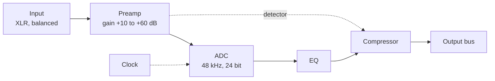
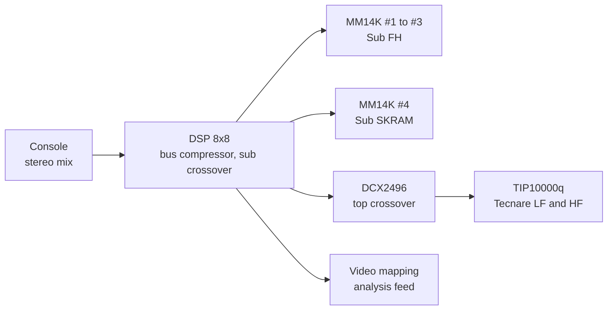

# 1. Signals and systems

> **Draft, pass 1.** This chapter was written from general knowledge and checked against reference literature for
> coverage. Standards, editions and figures are named but have not yet been verified against their sources. The
> list *To verify in pass 2* at the end names every claim that still needs one.

This chapter answers what travels through a sound system and what the system is made of. It starts with sound as a
pressure wave, explains phase and why it decides how two signals add, follows a modern signal chain from the
microphone to the listener, and ends with how to read and draw the block diagrams the rest of the book uses.

## Sound as a pressure wave

Sound is a small, fast variation of air pressure around the static atmospheric pressure. A loudspeaker cone that
moves forward pushes the air in front of it together, and the region of slightly higher pressure moves away from
the cone. When the cone moves back, a region of slightly lower pressure follows. The air itself barely travels.
What travels is the pattern of compression and rarefaction, passed on from one layer of air to the next.

Three quantities describe a steady tone.

- **Frequency** $f$ is the number of complete cycles per second, measured in hertz (Hz). Human hearing spans
  roughly 20 Hz to 20 kHz, with the upper limit falling with age (chapter 5).
- **Period** $T = 1/f$ is the duration of one cycle. A 1 kHz tone has a period of 1 ms, a 50 Hz tone one of 20 ms.
- **Wavelength** $\lambda = c/f$ is the distance one cycle occupies in the air, where $c$ is the speed of sound.

The speed of sound in air depends on temperature and hardly at all on air pressure or frequency. A linear
approximation that is good enough for sound system work is

$$c \approx 331.3 + 0.606\,T \quad \text{m/s, with } T \text{ in °C.}$$

| Air temperature | 0 °C | 10 °C | 15 °C | 20 °C | 25 °C | 30 °C | 35 °C |
|---|---:|---:|---:|---:|---:|---:|---:|
| Speed of sound (m/s) | 331.3 | 337.4 | 340.4 | 343.4 | 346.4 | 349.5 | 352.5 |

The difference matters wherever distances are converted into time. A delay tower 30 m behind the main system
needs 88.9 ms at 10 °C and 85.8 ms at 30 °C, so an alignment set in the cool afternoon is 3 ms off after a hot
evening. This book uses 343 m/s (20 °C) unless a section says otherwise.

Wavelength is the quantity that explains most of what loudspeakers, rooms and microphones do, because an object
only influences sound much when it is comparable in size to the wavelength or larger. The audible range covers
three decades of frequency and therefore three decades of wavelength.

| Frequency | 20 Hz | 50 Hz | 100 Hz | 250 Hz | 500 Hz | 1 kHz | 2 kHz | 4 kHz | 8 kHz | 16 kHz | 20 kHz |
|---|---:|---:|---:|---:|---:|---:|---:|---:|---:|---:|---:|
| Wavelength at 20 °C | 17.2 m | 6.87 m | 3.43 m | 1.37 m | 0.69 m | 0.34 m | 17 cm | 8.6 cm | 4.3 cm | 2.1 cm | 1.7 cm |

A 20 Hz wave is longer than most stages are deep, so no cabinet of portable size can steer it by its shape alone,
and subwoofer directivity has to come from several sources working together (chapter 14). A 16 kHz wave is shorter
than a thumb, so the grille of a microphone or a person's head is already a large obstacle to it.

The electrical signal in a cable is an analogue of the pressure wave. Within the working range of the equipment,
the voltage follows the pressure in time and is proportional to it. The size of the signal is its level, which is
always given in decibels relative to a stated reference. Chapter 3 is devoted to that.

## Phase, polarity and how signals add

**Phase** describes where in its cycle a periodic signal is at a given moment, measured against a reference. One
full cycle is 360°. A reference can be a fixed instant or another signal of the same frequency. When the output of
a device is compared with its input, a phase shift of 90° means the output crosses zero a quarter period later
than the input. A phase shift is always a statement about one frequency. A real device usually shifts different
frequencies by different amounts, which is why chapter 2 treats phase as a curve over frequency.

A **time delay** produces a phase shift that grows with frequency. One millisecond is 36° at 100 Hz, 360° at 1 kHz
and 3600° at 10 kHz. Delay and phase are therefore related but not the same thing. A delay shifts all frequencies
by the same time. A filter shifts different frequencies by different times.

**Polarity** is not phase. Swapping the two wires of a balanced connection, or pressing a "Ø" button, turns every
positive pressure into a negative one at all frequencies at once and without any delay. It looks like a 180° phase
shift on a sine wave, but on a kick drum it turns the first push of air into a pull, which no amount of delay can
reproduce. Equipment buttons labelled "phase" invert polarity, and this book calls them polarity switches.

When two signals meet, in a mixing bus or in the air, their instantaneous values add. For two signals of the same
level and frequency, the result depends on the phase between them.

| Phase between the two | Resulting amplitude | Level change against one signal |
|---|---:|---:|
| 0° (in phase) | 2× | +6.0 dB |
| 90° | 1.41× | +3.0 dB |
| 120° | 1× | 0 dB |
| 180° (opposite) | 0 | complete cancellation |

Two cases matter in practice and should not be confused.

- **Coherent** sources carry the same signal, such as two loudspeakers fed from the same output or a direct sound
  and its reflection. Their sum depends on the phase at each frequency, so it can be anything from +6 dB to a deep
  notch. Chapter 2 shows how a fixed time offset turns this into a comb of peaks and notches.
- **Incoherent** sources carry unrelated signals, such as two singers, two noise generators or the many
  reflections in a reverberant room. Their phases wander randomly against each other, and on average their powers
  add. Two equal incoherent sources are 3 dB louder than one.

This is why doubling the number of loudspeakers playing the same signal gives up to 6 dB at low frequencies, where
the boxes stay in phase across the audience, and closer to 3 dB at high frequencies, where small path differences
already scramble the phase.

## What a sound system is for

A sound reinforcement system makes sound louder, clearer or available somewhere else. The reasons fall into a few
groups.

1. **Intelligibility.** A speaker on a stage should be understood in the last row as well as in the first. The
   goal is clarity at a natural level, not loudness.
2. **Impact.** A band or a DJ set should feel larger than the unamplified source could. Here the level and the
   low-frequency energy are part of the artistic intent.
3. **Reach.** Overflow rooms, delay towers at a festival, a livestream or a hearing loop take the programme to
   people who are not in front of the source.
4. **Playback.** Recorded or generated material, from a DJ controller, a playback computer or a streaming device,
   is reproduced for an audience. Feedback is then no concern, but level, coverage and noise limits are.

The same physical principles apply to all four, and most real events mix them. A club night with a short speech is
a playback system for four hours and a speech reinforcement system for five minutes, and it has to be set up for
both.

## The signal chain

Every sound system converts sound into an electrical signal, processes and amplifies it, and turns it back into
sound in a room where people listen. In its simplest form this is three blocks, an input transducer, processing and
an output transducer. A modern system has that skeleton, but most of the processing happens on numbers rather
than voltages, and the room and the listener are part of the chain rather than a footnote.

**Input transducers** turn sound or another physical signal into an electrical one. Microphones turn air pressure
into voltage (chapter 9). Magnetic and piezo pickups turn string or body vibration into voltage. A DI box adapts the
high-impedance, unbalanced output of an instrument to a balanced microphone input. Playback devices skip the
acoustic step entirely, and many deliver a digital signal directly over USB, AES3 or a network.

**Conversion and transport.** A microphone delivers microvolts to millivolts. A preamplifier raises this to line
level, and an analog-to-digital converter (ADC) turns it into a stream of numbers. In a modern rig both sit in a
stagebox on stage, and the numbers travel over a network or a single digital multicore to the console (chapter 15).

**Mixing and processing.** The console sets the gain of each source, equalises, compresses, routes and mixes them
into the outputs the event needs (chapters 11 and 12). Today this is software running on dedicated hardware,
controlled from a surface, a laptop or a tablet.

**Loudspeaker processing.** A loudspeaker processor splits the mix into frequency bands for the different drivers,
delays the outputs so that boxes at different distances arrive together, equalises the boxes and limits each band
to what its driver survives (chapters 12, 14 and 20). In many current systems this happens inside the power
amplifier.

**Amplification.** The power amplifier turns a line-level signal of about a volt into tens or hundreds of volts
at the current the loudspeaker demands (chapter 13).

**Output transducers** turn the amplified signal back into sound. Woofers, midrange drivers, compression drivers
and their enclosures each cover part of the spectrum (chapter 14). Monitors and in-ear systems send a separate mix
back to the performers (chapter 18).

**Room and listener.** The loudspeaker's sound reflects, is absorbed, bends around obstacles and loses its highs
over distance (chapters 6 and 7). What reaches a person is that sound filtered through human hearing (chapter 5).
A system that measures well at one microphone position can still fail in the room, and a room can ruin a good
system. Design starts from the audience area and works backwards to the boxes.

The same chain has a **control layer** alongside the audio. Scene recall, remote control of amplifiers and
processors, clock synchronisation and timecode run beside the audio and sometimes over the same network
(chapter 19).

## Digital audio in brief

Nearly every modern system converts to digital audio at the stagebox and back to analog at or inside the amplifier.
Four properties of that conversion appear throughout the book.

**Sample rate.** The ADC measures the voltage at fixed intervals, 48 000 times per second in most live systems
(48 kHz), sometimes 96 kHz. A sampled signal can represent frequencies up to half the sample rate, the Nyquist
frequency, which is 24 kHz at 48 kHz. Anything above it must be filtered out before sampling, or it folds back as
an audible alias. Modern converters oversample internally and filter digitally, so this filter no longer shapes the
audible band the way the steep analog filters of early converters did.

**Bit depth.** Each sample is stored as a number with a fixed number of bits. Every bit doubles the number of
possible values and adds about 6.02 dB to the theoretical dynamic range of the format.

| Format | Theoretical range | Typical use |
|---|---:|---|
| 16 bit | 96.3 dB (98.1 dB for a full-scale sine) | CD, many playback files |
| 24 bit | 144.5 dB (146.2 dB for a full-scale sine) | converters, network audio, recording |
| 32 bit float | far beyond any converter | processing inside consoles and DSPs |

The theoretical figure is a property of the number format. Real 24-bit converters reach about 110 to 120 dB,
because analog noise in the converter sets the floor long before the last bits matter. Chapter 4 shows why this
makes the preamp gain the one decision that sets the noise floor.

**Full scale.** A digital signal has a hard ceiling, the largest number the format can hold, called 0 dBFS. Above
it the signal does not distort gradually as an overdriven analog stage might. It clips flat. Chapter 3 explains how
0 dBFS relates to analog levels.

**Latency.** Every conversion and every processing block takes time. An ADC and a DAC each add some tenths of a
millisecond to about a millisecond, a console path adds about one to a few milliseconds, a network hop adds a
configurable buffer, and a linear-phase FIR filter can add several more. Latency is a property of the whole system,
not of one device, and it adds up.

| Latency | 0.5 ms | 1 ms | 2 ms | 5 ms | 10 ms |
|---|---:|---:|---:|---:|---:|
| Equivalent distance at 20 °C | 0.17 m | 0.34 m | 0.69 m | 1.72 m | 3.43 m |

The conversion to distance is the useful way to think about it. A total of 2 ms between a singer's mouth and the
front-of-house loudspeaker is the same as standing 0.7 m further away, which nobody notices. The same 2 ms in a
singer's in-ear monitor competes with the sound conducted through their own skull, which some performers notice
as a phasey or hollow voice (chapter 18). Latency differences between paths that are mixed together are worse than
latency itself, because they create comb filters (chapter 2). Consoles compensate internal path differences
automatically, but a signal routed out to an external processor and back may not be compensated.

## Reading and drawing block diagrams

A block diagram shows how a signal flows through a device or a system. It treats each function as a box and leaves
out the components that implement it. A schematic is the opposite. It shows every resistor, transistor and
connection, including power and ground, and is drawn for the person who repairs the device. The user needs the
block diagram, because it answers how the device works and where its controls act.

Manufacturers still publish block diagrams for consoles, processors and amplifiers, although the symbol sets have
drifted apart over the years. Older references collect symbol sheets for amplifiers, switches, transformers,
grounds, meters, connectors and filters. Such sheets are less useful today, because a digital device is mostly
software and its diagrams are mostly labelled boxes. The rules for reading a diagram have outlived the
symbols.

1. **Signal flows from left to right**, and top to bottom where a diagram wraps. An arrow is drawn only where a
   path runs against that direction, such as a feedback path or a side chain.
2. **Follow one path at a time.** Start at an input, follow it to an output, and only then return to the branches.
3. **Find where each control acts.** A gain control before a processing stage changes how hard that stage is driven.
   The same control after it only changes the output level. This difference decides noise and headroom (chapter 4).
4. **Separate audio from control.** Side-chain detectors, clocks and remote control paths carry no audio, even
   when they are drawn with the same lines.
5. **Do not assume what the diagram does not say.** Polarity is the classic example. A diagram may show a
   balanced input and output without saying whether the device inverts the signal. The data sheet or a
   measurement settles it (chapter 16). Since the AES and IEC standardised pin 2 as the positive pin of an XLR
   connector, inverting devices have become rare, but they still exist.
6. **When in doubt, draw a box and label it.** A well-labelled rectangle is better than a symbol the reader has
   to guess.

The same technique applies to whole systems. A system diagram that shows every source, every bus, every processor
output and every amplifier channel is the best tool for finding a missing feed or a doubled path before the event,
and the fastest map for troubleshooting during it.

### Diagram conventions in this book

The diagrams in this book are Mermaid flowcharts that GitHub renders from the text of the page. They follow the
reading rules above.

- Flow runs left to right (`flowchart LR`).
- A box is a device or a function, and its label names it in plain words, with the second line giving its role.
- An arrow is a signal path. A dotted arrow (`-.->`) is a control or clock path that carries no audio.
- Acoustic paths, such as loudspeaker to room, are drawn like electrical ones, because for the system they are just
  another stage in the chain.

The second example reads as follows. A balanced input feeds a preamp with a variable gain, the signal is converted
at 48 kHz and 24 bits and then equalised and compressed on its way to an output bus. The compressor's detector is
fed from before the converter, which is unusual and worth noticing, and the converter runs from a clock that does
not carry audio. Each of these facts could matter during an event, and the diagram makes them visible in seconds.

## In the SdWa5 rig

The SdWa5 event rig follows the chain above with two loudspeaker processors in series with the console's output.
A DSP 8x8 feeds the subwoofer amplifiers directly and passes the tops to a Behringer DCX2496, which splits them into
low and high bands for a four-channel amplifier. The rig's patch, the reason the second processor was needed and the
complete limiter table are documented in [Signal chain](../../sdwa5-3d/docs/signal-chain.md).

The rig shows two points of this chapter. The audio leaves the 8x8 on two outputs and returns on two inputs to pass
through the bus compressor, so a block diagram without that loop would misstate where the compressor acts. The video
mapping machine takes a copy of the mix as a control signal, which is the kind of path rule 4 above separates from
audio.

## To verify in pass 2

- Speed of sound approximation $331.3 + 0.606\,T$ and its error against the exact formula across −10 to 40 °C;
  check against ISO 9613-1 or a physics reference.
- Typical ADC, DAC and console latencies quoted as tenths of a millisecond to a few milliseconds; check against
  current converter and console data sheets.
- Real 24-bit converter dynamic range of about 110 to 120 dB; check against current converter data sheets and AES17
  measurement conditions.
- Pin 2 as the positive XLR pin, attributed to the AES and IEC; check AES26 and IEC 60268-12.
- Upper hearing limit falling with age; check ISO 7029 (handled in chapter 5).

## Sources

- ISO 9613-1, attenuation of sound during propagation outdoors, part 1, for the speed of sound and air absorption.
- AES17, measurement of digital audio equipment, for full scale and dynamic range.
- AES26 and IEC 60268-12, for connector pin assignment.
- SdWa5: [Signal chain](../../sdwa5-3d/docs/signal-chain.md), the rig documented in this chapter.
- Davis, G., Jones, R.: *The Sound Reinforcement Handbook*, 2nd ed., Yamaha / Hal Leonard 1989, §1 (pp. 1–8) and §7
  (pp. 61–70).
