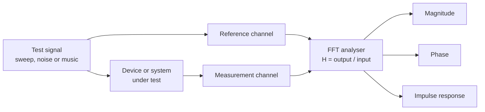

# 2. Frequency, phase and time

> **Draft, pass 1.** This chapter was written from general knowledge and checked against the 1989 handbook for
> coverage. Standards, editions and figures are named but have not yet been verified against their sources. The
> list *To verify in pass 2* at the end names every claim that still needs one.

This chapter answers how a device or a system changes a signal depending on its frequency, and why time and phase
belong in the same picture as level. It introduces the transfer function, the frequency bands used for measurement
and equalisation, filters and their slopes, the frequency content of voices and instruments, and the comb filter
that appears whenever a signal meets a delayed copy of itself. It replaces handbook §2 (pp. 9–18), §8.9 (pp. 99–100)
and the square-wave part of §8.10 (pp. 100–103).

## The transfer function

The handbook defined frequency response with a sine generator, a black box and a level meter. The generator is swept
across the audio band at constant level, and the output level is plotted against frequency. The plot shows which
frequencies pass and how much each one is raised or lowered.

That plot is half of the description. Any linear device changes two things at each frequency, the **magnitude**
(how much larger or smaller the output is) and the **phase** (how far the output is shifted in time against the
input). Together they form the **transfer function** $H(f)$. Two devices with identical magnitude curves can sound
different and combine differently with other devices if their phase curves differ.

The transfer function has a twin in the time domain, the **impulse response**. It is the output of the device when
the input is a single, infinitely short click. The impulse response and the transfer function contain exactly the
same information, and the Fourier transform (computed as an FFT) converts one into the other. Modern measurement
software never sweeps a sine slowly past a meter. It plays a known signal, such as a sweep, pink noise or the
programme itself, records the output, and computes the transfer function by comparing output and input (chapter 16).

Reading a magnitude plot needs three habits.

- **Look for the tolerance.** "30 Hz to 18 kHz" says nothing until a tolerance such as ±3 dB is added, and nothing
  reliable until the measurement conditions are stated. Chapter 8 deals with reading specifications.
- **Look for the smoothing.** A curve averaged over a third of an octave hides narrow peaks and dips that a 1/24
  octave curve shows. Both are honest, but they answer different questions.
- **Look at the axes.** A vertical scale of 50 dB makes a ±3 dB ripple disappear. A scale of 10 dB makes it look
  dramatic.

Electronic devices such as preamps, mixing busses and power amplifiers are flat across the audio band to within a
fraction of a decibel, unless they are meant to shape it. Microphones and loudspeakers are not flat, and the room is
the least flat element of all. The response of the whole chain is the product of the individual responses, which in
decibels means the sum. A loudspeaker 3 dB down at 60 Hz in a room that adds 8 dB at 60 Hz produces a 5 dB peak at
the listener.

## Octaves, decades and standard bands

Hearing judges frequency by ratio, not by difference. The step from 100 Hz to 200 Hz sounds like the same musical
interval as the step from 1 kHz to 2 kHz, although the second spans ten times as many hertz. A ratio of 2:1 is an
**octave**, a ratio of 10:1 a **decade**, and one decade holds about 3.32 octaves. Frequency axes in audio are
therefore logarithmic, with each decade taking the same width.

For measurement and for graphic equalisers, the audio band is divided into standard bands of one octave or one third
of an octave. Their centre frequencies are defined in ISO 266 and the filters in IEC 61260-1. The exact centres
follow the base-ten series $f_m = 1000 \cdot 10^{n/10}$ Hz for third-octave bands, which gives 1000, 1259, 1585,
1995, 2512 Hz and so on. The base-two series $1000 \cdot 2^{n/3}$ gives almost the same values, because $10^{0.1}$
(1.2589) and $2^{1/3}$ (1.2599) differ by less than 0.1 %. Both are rounded to the familiar nominal labels.

| Nominal third-octave centres (Hz) | | | | | | | | | |
|---|---|---|---|---|---|---|---|---|---|
| 20 | 25 | 31.5 | 40 | 50 | 63 | 80 | 100 | 125 | 160 |
| 200 | 250 | 315 | 400 | 500 | 630 | 800 | 1 k | 1.25 k | 1.6 k |
| 2 k | 2.5 k | 3.15 k | 4 k | 5 k | 6.3 k | 8 k | 10 k | 12.5 k | 16 k |

The octave centres are every third entry, from 31.5 Hz to 16 kHz. An equaliser whose bands sit on these centres
matches a real-time analyser that uses the same standard, which was the point of the standard in 1989 and remains so.

Band measurements with **pink noise** were the main tool of the handbook's time. Pink noise has equal energy in every
octave, so it shows a flat line on a band analyser when the system is flat. Its weakness is the same as its
strength. A third-octave band averages everything inside it, so a deep notch 1/12 octave wide disappears, and in a
reverberant room the result says more about the room than about the loudspeaker. Chapter 16 explains why
dual-channel FFT measurements have largely replaced it.

## Phase, group delay and minimum phase

A **phase response** shows the phase shift at each frequency. On its own it is hard to read, because a pure time
delay produces a phase that falls steadily with frequency and wraps around every 360°. Two derived views are more
useful.

**Group delay** is the time by which each part of the spectrum is delayed. For a pure delay it is flat, the same for
all frequencies. For a filter it peaks around the filter's corner frequency. A loudspeaker typically delays its low
frequencies by several milliseconds more than its highs, which is one reason a kick drum through a large system can
sound late against the hi-hat even when every box is aligned.

**Minimum phase** describes systems whose phase follows directly from their magnitude. Most analog filters, single
loudspeaker drivers, and most acoustic effects that are not reflections behave this way. For such systems, an
equaliser that corrects the magnitude also corrects the phase. A reflection, or the overlap of two drivers at
different distances, is not minimum phase. Equalisation cannot fix it, because its cause is a time difference, and
the cure is to change the time difference or the geometry (chapter 20).

**Linear phase** means the same delay at every frequency, which keeps the shape of a waveform intact. FIR filters
(see below) can be designed to have linear phase. Analog and IIR filters cannot.

## Filters and slopes

Filters pass some frequencies and attenuate others. The basic types are the **high-pass** (low cut), the
**low-pass** (high cut), the **band-pass** and the **notch** (band stop). Equalisers, crossovers and limiter side
chains are all built from them.

A filter is described by its corner frequency, its slope and its shape.

- The **corner** or turnover frequency of a high-pass or low-pass filter is usually the point where the level has
  dropped 3 dB from the pass band. Linkwitz-Riley crossovers are the exception, with the corner at −6 dB (see below).
- The **slope** is how fast the level falls beyond the corner, in dB per octave. Each order, called a pole in analog
  design, adds about 6 dB per octave. A second-order filter falls at 12 dB per octave, a fourth-order one at 24 dB
  per octave. Digital filters reach 48 dB per octave and more without effort.
- The **shape** near the corner is set by the filter alignment.

| Butterworth high-pass order | 1 | 2 | 3 | 4 | 8 |
|---|---:|---:|---:|---:|---:|
| Asymptotic slope (dB per octave) | 6 | 12 | 18 | 24 | 48 |
| Attenuation one octave below the corner | 7.0 dB | 12.3 dB | 18.1 dB | 24.1 dB | 48.2 dB |
| Attenuation two octaves below the corner | 12.3 dB | 24.1 dB | 36.1 dB | 48.2 dB | 96.3 dB |

Near the corner the attenuation is a little more than the slope suggests, and from one octave on it settles to the
slope. An 80 Hz third-order high-pass is 18 dB down at 40 Hz and 36 dB down at 20 Hz, which removes stage rumble,
handling noise and wind without touching a voice. The exact numbers depend on the alignment, and other alignments
than Butterworth reach several decibels more or less one octave out.

Three alignments cover nearly all practical use.

- **Butterworth** is as flat as possible in the pass band and −3 dB at the corner. It is the common choice for
  high-pass filters on input channels and for protecting subwoofers.
- **Linkwitz-Riley** is two Butterworth filters in series and is −6 dB at its corner. Its purpose is crossovers. A
  Linkwitz-Riley low-pass and high-pass at the same frequency add to a flat magnitude, because both are −6 dB at the
  crossover and in phase with each other there. The fourth-order version (LR24) is the standard crossover in live
  sound.
- **Bessel** has the gentlest corner and the most constant group delay of the three. It keeps transients cleanest
  and is used where that matters more than a sharp corner.

For band-pass and peaking filters, the width is given as a **Q**, the centre frequency divided by the bandwidth
between the −3 dB points, or as a bandwidth in octaves. A Q of 1.41 is about one octave wide, a Q of 4.3 about a
third of an octave. Equalisers use the same idea for the width of a boost or cut (chapter 12).

**IIR and FIR.** Digital filters come in two families. IIR (infinite impulse response) filters copy the behaviour of
analog filters, with the same slopes, the same phase shifts and almost no latency. FIR (finite impulse response)
filters compute each output sample as a weighted sum of many past input samples, the taps. They can shape magnitude
and phase independently, so a crossover can be steep and linear-phase at the same time. The price is latency and,
for low frequencies, a large number of taps.

| FIR length at 48 kHz | 512 taps | 1024 taps | 2048 taps | 4096 taps |
|---|---:|---:|---:|---:|
| Latency of a linear-phase design | 5.3 ms | 10.7 ms | 21.3 ms | 42.7 ms |
| Frequency resolution, roughly | 94 Hz | 47 Hz | 23 Hz | 12 Hz |

This is why FIR filters are common for the mid and high bands of loudspeaker processing, where a few hundred taps
suffice, and rare in subwoofer crossovers, where a useful filter would delay the whole system by tens of
milliseconds.

## Voices, instruments and harmonics

The frequency range a system needs depends on what it reproduces.

**Speech** carries most of its energy below about 1 kHz, but its intelligibility lives in the consonants between
about 1 and 8 kHz. Cutting the highs costs far more understanding than cutting the lows. Classic telephony passed
only 300 Hz to 3.4 kHz and was understandable but tiring. Current wideband and super-wideband telephony passes much
more, and a speech reinforcement system should be reasonably flat from about 100 Hz to 8 kHz. The octave bands from
125 Hz to 8 kHz are the ones in which speech intelligibility is measured (chapter 7). A broad presence lift of a few
decibels between 2 and 5 kHz can raise intelligibility, but it also brings the system closer to feedback at the
frequencies where most vocal microphones and monitors are already strong.

**Music** has no fixed range. The fundamentals of most instruments lie between about 30 Hz and 4 kHz, but the
character of a sound comes from its overtones, and electronic music can put energy anywhere from below 30 Hz to the
top of hearing.

| Source | Approximate fundamental range |
|---|---|
| Kick drum, body | 40–100 Hz |
| Electric bass, four strings | 41–400 Hz |
| Male speaking voice | 85–180 Hz |
| Female speaking voice | 165–255 Hz |
| Piano | 27.5 Hz–4.2 kHz |
| Violin | 196 Hz–3.5 kHz |
| Synthesiser, sub bass | down to 20 Hz and below |

A pitched sound consists of a **fundamental** and **harmonics** at whole-number multiples of it. An A at 440 Hz has
harmonics at 880, 1320, 1760, 2200 Hz and upward, and the relative strength of these components decides whether the
note sounds like a flute, a violin or an oboe. Sounds whose components are not whole-number multiples, such as most
drums and cymbals, lose a clear pitch and approach noise. Because timbre lives in the balance of components across
many octaves, a system whose response is rough changes the character of every source it reproduces, even when its
nominal range is wide.

## The comb filter

When a signal is added to a copy of itself delayed by $\Delta t$, the two copies are in phase at some frequencies and
opposite at others. They cancel where the delay equals half a period, one and a half periods, and so on, which is at
odd multiples of $1/(2\Delta t)$. Between the notches they add up to +6 dB. The magnitude plot looks like the teeth of
a comb, evenly spaced on a linear frequency axis and crowding together towards the top of a logarithmic one.

$$f_{\text{notch},k} = \frac{2k + 1}{2\,\Delta t}, \quad k = 0, 1, 2, \dots$$

| Delay | Path difference at 20 °C | First notches | Notch spacing |
|---|---:|---|---:|
| 0.5 ms | 0.17 m | 1, 3, 5, 7 kHz | 2 kHz |
| 1 ms | 0.34 m | 500, 1500, 2500, 3500 Hz | 1 kHz |
| 2 ms | 0.69 m | 250, 750, 1250, 1750 Hz | 500 Hz |
| 5 ms | 1.72 m | 100, 300, 500, 700 Hz | 200 Hz |

Comb filters appear everywhere in sound reinforcement.

- Two microphones picking up the same source at different distances, mixed together.
- A microphone on a lectern picking up the voice directly and via the lectern surface.
- Two loudspeakers covering the same seats from different distances.
- A loudspeaker and its reflection from a nearby wall or floor.
- Two paths through a console or a network with different latency, mixed into the same bus.

The cure depends on the cause. Mixing two microphones on one source is fixed by using one, by moving one so that its
level is at least about 10 dB lower than the other, or by delaying one so the copies line up. Loudspeaker overlap is
fixed by aiming, by splitting coverage, or by delaying the nearer box so that both arrive together at the seats that
matter. No equaliser can fix a comb filter, because the notches move with the listening position.

## Square waves and other legacy tests

The handbook described square-wave testing with an oscilloscope. A square wave contains a fundamental and all its odd
harmonics in a fixed ratio, so a circuit that changes the magnitude or phase of any of them changes the shape of the
square. A sloping top showed a low-frequency roll-off, rounded corners showed limited high-frequency response, and
ripples after each edge showed ringing.

The method still works and is quick with a USB oscilloscope (chapter 16), but it has lost its central role. An
impulse response and transfer function from a dual-channel FFT analyser show the same information as numbers and
curves, for the whole system including loudspeakers and room, and they do it with music as the test signal. The
handbook's own warnings still apply. A square wave is not a musical signal, no loudspeaker can reproduce one, and a
circuit that rounds a square wave can sound excellent.

## What changed since 1989

| Handbook | Then | Today |
|---|---|---|
| §2.1 | Frequency response as magnitude from a sine sweep and a meter | Transfer function with magnitude, phase and impulse response from FFT measurement |
| §2.1.1 | Response specifications and tolerances | Kept briefly, detail moved to chapter 8 |
| §2.1.2 | ISO third-octave bands, pink noise and band analysers | Same bands per ISO 266 and IEC 61260-1, band analysers complemented by dual-channel FFT |
| §2.2.1 | Cable capacitance and amplifier band limits, steep converter filters | Cables moved to chapter 15. Oversampling converters no longer shape the audible band |
| §2.2.2 | Microphone response peaks and one manufacturer's new models | Moved to chapter 9 without product references |
| §2.2.3 | Loudspeakers ±4 dB per third octave as very good, full range from about 100 Hz | Moved to chapter 14. DSP-corrected boxes reach much lower and flatter |
| §2.3.1 | Speech needs 300 Hz to 3.5 kHz minimum, PA flat 100 Hz to 8 kHz | Kept, with wideband telephony and the octave bands used for intelligibility measurement |
| §2.4 | Wind, temperature, humidity, reflections and room resonances | Moved to chapters 6 and 7 |
| §8.9 | Slopes in multiples of 6 dB per octave, turnover at −3 dB | Kept, plus alignments, Q, Linkwitz-Riley crossovers, group delay and FIR filters |
| §8.10 | Square-wave tests on an oscilloscope | History. Impulse and transfer function measurement replaced them |

## To verify in pass 2

- ISO 266 and IEC 61260-1 as the references for preferred frequencies and fractional-octave filters, the current
  editions, and whether IEC 61260-1 prescribes base-ten or base-two band edges.
- The Q to bandwidth relations (Q 1.41 for one octave, Q 4.3 for a third octave); check against a filter design
  reference.
- The handbook's figure of 21 dB at 40 Hz for an 80 Hz third-order high-pass against the Butterworth value of
  18.1 dB computed here; the difference presumably comes from the alignment and changes no advice.
- The fundamental ranges in the voice and instrument table; check against an acoustics of music reference.
- The speech energy and consonant band figures and the 300 Hz to 3.4 kHz telephony band; check against ITU-T
  recommendations and IEC 60268-16.
- The statement that loudspeakers typically delay their low frequencies by several milliseconds more than their highs;
  check against published group delay measurements.

## Sources

- Davis, G., Jones, R.: *The Sound Reinforcement Handbook*, 2nd ed., Yamaha / Hal Leonard 1989, §2 (pp. 9–18),
  §8.9 (pp. 99–100), §8.10 (pp. 100–103).
- ISO 266, preferred frequencies for acoustical measurements.
- IEC 61260-1, octave-band and fractional-octave-band filters.
- IEC 60268-16, objective rating of speech intelligibility by speech transmission index.
- Linkwitz, S. H.: *Active crossover networks for noncoincident drivers*, Journal of the AES, 1976.
