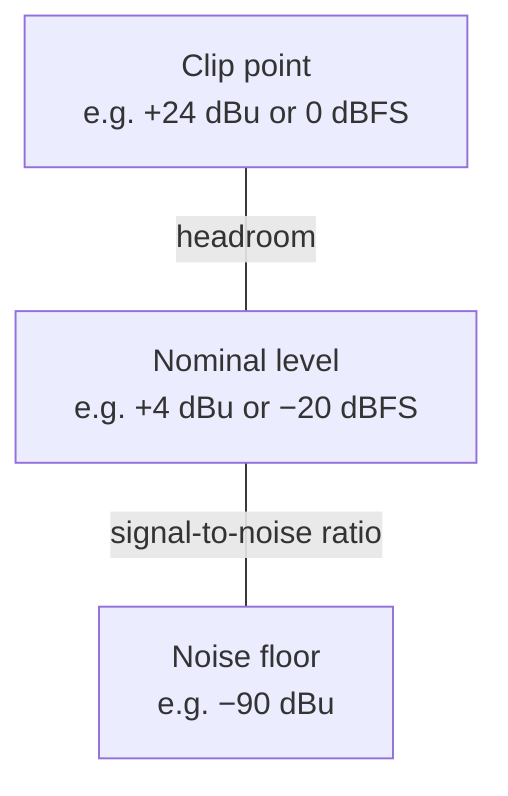

# 4. Dynamic range, headroom and gain structure

> **Draft, pass 1.** This chapter was written from general knowledge and checked against the 1989 handbook for
> coverage. Standards, editions and figures are named but have not yet been verified against their sources. The
> list *To verify in pass 2* at the end names every claim that still needs one.

This chapter answers how loud and how quiet a system can be at the same time, where its limits sit, and how to set
the gain of every stage so the programme stays between the noise floor and the clip point. It defines dynamic range,
headroom and signal-to-noise ratio, works through a gain chain from microphone to converter, shows how the outputs of
a console, a processor and an amplifier are matched, and explains how compression fits a wide programme into a
narrower system. It replaces handbook §4 (pp. 33–42) and §11.7 (pp. 172–175).

## Three ranges

**Dynamic range** is the distance in decibels between the loudest and the quietest part of something. For a
programme it is the distance from its highest peak to its quietest passage, or to the noise around it if that noise
masks the quietest passage. For a system it is the distance from its maximum output, where it clips, to its noise
floor.

**Headroom** is the distance from the nominal level, where the programme sits most of the time, to the clip point.
It is the reserve for peaks.

**Signal-to-noise ratio** (S/N) is the distance from the nominal level down to the noise floor.

All three are differences, so they are given in plain dB, never in dBu or dB SPL. A system with a nominal level of
+4 dBu, a clip point of +24 dBu and a noise floor of −90 dBu has 20 dB of headroom, 94 dB of S/N and a dynamic range
of 114 dB.

Headroom plus S/N equals the dynamic range as defined here. The handbook pointed out a subtlety that still holds.
A listener can follow structured programme such as a voice or a tone several decibels below broadband noise, so the
usable range of a system is slightly larger than its measured one. Measuring from the noise floor is the safer and
repeatable convention.

## The programme and the system

A loud concert can span 85 dB at the microphone, from 40 dB SPL during a pause to 125 dB SPL on a shouted peak. In a
linear chain, with no compression or limiting, every stage reproduces those 85 dB. The console output swings 85 dB
in voltage, the amplifier 85 dB in power, and the loudspeakers 85 dB in sound pressure. A decibel of change at the
microphone is a decibel of change everywhere, whether the stage is described in volts, watts or pascals.

A chain is only as wide as its narrowest stage. If one stage offers 74 dB between its noise and its clip point, an
85 dB programme loses 11 dB somewhere. The loss shows up as clipped peaks, as quiet passages buried in hiss, or as
both. Since the 1980s the narrow stages have moved. Analog consoles, tape and the summing amplifiers that limited the
handbook's systems have given way to converters with well over 100 dB of range and floating-point mixing that does
not clip internally. In a modern rig the narrowest stages are usually

- the **room**, where the audience noise sets a floor of 60 to 80 dB(A) at a busy event,
- the **loudspeakers and amplifiers**, whose maximum output sets the ceiling, and
- the **limits** for audience exposure and for neighbours (chapters 5 and 6), which set a ceiling below the
  equipment's own.

The handbook's observation that every extra 3 dB of maximum level costs twice the amplifiers and loudspeakers is
still true, and it is the main reason to manage the programme's range rather than build a system wide enough for
everything.

## How much headroom

The headroom a system needs is set by the crest factor of its programme, the distance from its average to its peaks
(chapter 3).

| Programme | Typical crest factor | Headroom to plan for |
|---|---:|---:|
| Paging, announcements, compressed speech | 6–10 dB | about 10 dB |
| Modern mastered pop and electronic music | 6–10 dB | about 10–12 dB |
| Live band, mixed with moderate compression | 12–15 dB | about 15 dB |
| Acoustic ensembles, orchestra, theatre | 15–20 dB and more | about 20 dB |

These are planning figures, not limits. A system that plays electronic music at a nominal 100 dB(A) needs peak
capability around 110 to 112 dB at the same position, while a chamber orchestra at a nominal 85 dB(A) needs peaks of
105 dB. The same equipment can serve both, because the orchestra needs a lower average. The handbook made this point
with a symphony that needed more headroom but not more amplifiers.

The headroom is usually the first thing given away when a system is too small. Running out of headroom does not
announce itself on an average-reading meter. It shows as limiters working continuously, as a compressed and
fatiguing sound, and on the amplifier as clip indicators flashing on every kick drum.

## Gain structure in a digital chain

Gain structure means setting each stage so the programme uses its range well, far enough above the noise and far
enough below the clip point. The handbook's rule was to take as much gain as possible at the first stage and to
avoid making up level later. In a digital system the rule becomes more precise. **The preamp gain is the one decision
that sets both the noise floor and the headroom of a channel.** Everything after the converter is computed with so
much range that it neither adds noise nor clips inside the mixing engine, until the signal is converted back or
leaves on a fixed-point output.

### A worked example

A vocalist sings into a dynamic microphone with a sensitivity of 2 mV/Pa. The loudest peaks reach 125 dB SPL at the
capsule, and the quietest phrase is 45 dB SPL. The stagebox has a preamp with an equivalent input noise of −127 dBu
and a converter with a noise floor of −112 dBFS, aligned so that 0 dBFS equals +18 dBu.

| Quantity | Value |
|---|---:|
| Microphone output on peaks (125 dB SPL) | −20.8 dBu |
| Microphone output on the quiet phrase (45 dB SPL) | −100.8 dBu |
| Target for peaks at the converter | −12 dBFS, which is +6 dBu |
| Preamp gain needed | 26.8 dB |
| Preamp noise after gain | −100.2 dBu, which is −118.2 dBFS |
| Total noise with the converter's −112 dBFS | −111.1 dBFS |
| Quiet phrase at the converter | −92.0 dBFS, 19 dB above the noise |

With the gain set 15 dB lower, "to be safe", the peaks reach only −27 dBFS. The preamp's noise falls to −133 dBFS,
but the converter's −112 dBFS stays where it is, so the total noise barely moves. The quiet phrase arrives at
−107 dBFS, now only 5 dB above the noise. The 15 dB of gain that was given away at the preamp cannot be recovered
later, because every fader and every make-up gain afterwards raises noise and signal together.

With the gain set 15 dB higher, the peaks hit +3 dBFS and clip at the converter. No fader afterwards removes that
distortion.

The example shows the shape of the decision. Up to the point where the preamp's own noise dominates, more gain is
always better. Beyond the point where peaks approach full scale, more gain is destructive. Between the two there is a
window of 15 to 20 dB, and the target of peaks around −12 to −18 dBFS keeps a source in it while leaving room for a
singer who gets louder in the final chorus.

### Setting the gain in practice

1. Put the channel fader and the master at their nominal position, 0 dB on a digital console.
2. Ask for the loudest realistic performance, not a polite soundcheck level. Drummers and singers play louder in the
   show than in the check.
3. Raise the preamp gain until the channel meter peaks around −12 to −18 dBFS, depending on how predictable the source
   is.
4. Engage a pad only if the gain at its minimum still lets the source clip. A pad is an attenuator before the preamp,
   so it reduces signal and preamp noise alike, but the converter noise then sits closer to the signal. With
   condenser microphones in kick drums or guitar cabinets a pad is often necessary (chapter 3).
5. Mix with the faders. If a channel fader ends up far below 0 dB for the whole show, the gain is set too high, and
   if it is at the top, the gain is too low.

### Split systems and gain sharing

When the front-of-house and monitor consoles share one stagebox, one preamp gain serves both. Whoever changes it
changes the other console's level too. Digital systems solve this with **gain compensation** or gain sharing. One
console owns the analog gain, and the other receives the signal with a digital trim that automatically offsets every
change of the analog gain, so its level stays constant. The same principle applies to a broadcast or recording split
taken from the same preamps. Chapter 11 covers splits in detail.

### Floating point inside, fixed point at the edges

Consoles and processors compute internally in 32-bit or 64-bit floating point, which has a range of more than
1500 dB. A bus that is driven 20 dB over 0 dBFS inside the engine does not clip, as long as the level is brought down
before it leaves. Analog summing amplifiers in the handbook's consoles clipped when too many channels were pushed
together, and a lot of its advice addressed that. In a digital console the risk has moved to the outputs. A DAC, an
AES output, a network output and the input of the next device are fixed-point and clip at their full scale.

Recorders that write 32-bit floating-point files have the same property for recording. A take that goes over full
scale can be turned down afterwards without distortion, provided the converters themselves did not clip. Some
recorders use two converters at different gains for this purpose. This makes recording safer, but it does not change
the gain structure of the live chain, where a fixed-point output still clips.

## Matching the stages after the console

After the console the chain is console output, loudspeaker processor, power amplifier and loudspeaker. Each stage
has a maximum level, and the goal is that each one reaches its maximum at about the same time, so no stage clips
early and none wastes range.

- The **console output** has a maximum analog level, such as +18 or +24 dBu.
- The **processor input** has a maximum level that should be at least as high as the console's output.
- The **processor output** has a maximum level and, in every serious system, a limiter per band.
- The **amplifier** has a voltage gain or an input sensitivity, the input level that drives it to full output.
- The **loudspeaker** has a maximum voltage it survives, derived from its power rating and impedance.

A typical mismatch looks like this. A processor that delivers +18 dBu (6.15 V) feeds an amplifier with 32 dB of gain.
At full processor output the amplifier would try to produce 245 V. The amplifier can only deliver 89 V into 4 Ω,
its 2000 W rating. It reaches full output with a processor level of +9.2 dBu, so the top 8.8 dB of the processor's
range drive the amplifier into clipping. The limiter in the processor must therefore act at or below +9.2 dBu, and
lower still if the loudspeaker cannot take the amplifier's full output.

The arithmetic that turns a loudspeaker's rating, an amplifier's gain and a processor's ceiling into a limiter
threshold is four lines long. It is written out, with the reasons for its two common mistakes, in the SdWa5 rig
documentation under [Why 32 dB and 26 dB](../../sdwa5-3d/docs/signal-chain.md#why-32-db-and-26-db). Two of its
conclusions apply to any rig.

- **The lowest amplifier gain that leaves a safe margin is the right one.** A higher gain moves the limiter threshold
  down one for one and wastes the processor's range near its noise floor. The amplifier is not louder for it.
- **Paralleling loudspeakers on one amplifier channel does not change the threshold**, because each box still sees
  the same voltage. The impedance and power in the calculation are always those of one box.

When an amplifier has no input attenuator, the level reduction belongs in the processor's output gain or the
amplifier's gain switch, never in a console master pulled far down. A master fader at −30 dB throws away 30 dB of the
console output's range and brings its noise closer.

## Compression and limiting as range management

When the programme is wider than the system, or wider than the room and the limits allow, some of its range must be
removed deliberately. A **compressor** above its threshold changes the output by less than the input. At a ratio of
2:1, every 2 dB of input above the threshold become 1 dB of output. A **limiter** is a compressor with a high ratio,
10:1 to ∞:1, that holds peaks at or near the threshold.

The handbook's example compressed a whole programme. Fitting 90 dB into 74 dB needs a ratio of about 1.22:1 across
the full range, a gentle setting that keeps most of the music's movement. A more common approach is to leave
everything below a threshold untouched and compress only above it. A limiter with a threshold of +15 dBu and a ratio
of 10:1 lets an input of +25 dBu out at +16 dBu.

In live sound three layers of dynamics control are usual.

1. **Channel compressors** on voices and some instruments keep each source in its window.
2. **Bus or master compression** keeps the mix consistent and controls the crest factor the system has to carry.
3. **Loudspeaker limiters** in the processor or the amplifier protect the drivers and the amplifiers. They should
   almost never act audibly. When they work continuously, the system is too small for the level asked of it.

Chapter 12 covers the processors and their settings. The handbook also described tape noise reduction, which
compressed the signal before the tape and expanded it after. Tape has left the live chain. Compander circuits
survive in analog wireless systems (chapter 10).

## What changed since 1989

| Handbook | Then | Today |
|---|---|---|
| §4.1 | Concert example 40 to 130 dB SPL at the microphone, levels through the chain | Same principle, own example with a converter in the chain |
| §4.2.1 | Headroom, S/N and dynamic range with an analog console | Same definitions, applied to dBFS and dBu alike |
| §4.2.2 | Paging 6 dB, rock 20 dB, orchestra 30 dB of headroom | Headroom tied to the crest factor of the programme |
| §4.3.2 | A rented console with 74 dB of range as the weak link | Weak links are now the room, the loudspeakers and the exposure limits |
| §4.3.3 | Compression ratios, limiters, tape companders | Compression kept briefly, detail in chapter 12. Tape companders dropped |
| §4.3.4 | 15–20 dB hi-fi, 10 dB SR, 5–6 dB paging | Table by programme type |
| §11.7.1 | 10 µV to 10 V at the console input, 170 dB including a noise margin | Same problem, solved by preamp gain before a converter |
| §11.7.2 | Faders near the top, gain until the VU meter peaks near zero | Faders at 0 dB, gain until peaks reach −12 to −18 dBFS |
| §11.7.3 | Pad last, pads cost S/N, transformer saturation | Kept, condenser microphones as the usual reason for a pad |
| §11.7.4 | Summing amplifier overload in analog mixers | Floating-point busses do not clip internally. Outputs still do |
| — | Not covered | Gain sharing in split systems, 32-bit float recording, processor-to-amplifier matching with limiter thresholds |

## In the SdWa5 rig

The rig's limiter table, the choice of 32 dB on the MM14K amplifiers and 26 dB on the TIP10000q, and the bench
measurement that showed the DSP 8x8 clipping at about +12.5 rather than its documented 18 are in
[Signal chain](../../sdwa5-3d/docs/signal-chain.md#why-32-db-and-26-db). That section is the worked example for the
matching rules above, measured on real equipment.

## To verify in pass 2

- The equivalent input noise of −127 dBu and the converter noise floor of −112 dBFS used in the worked example; check
  against current stagebox data sheets.
- The gain target of peaks between −12 and −18 dBFS; check against console manufacturers' guidance and AES or EBU
  recommendations.
- The crest factors and headroom figures in the programme table; check against AES2-2012, IEC 60268-1 programme
  simulation noise and published loudness analyses.
- The internal floating-point formats of current consoles and processors (32-bit or 64-bit).
- The behaviour of 32-bit floating-point recorders with dual converters; check manufacturer documentation.
- Typical audience noise of 60 to 80 dB(A) at busy events; check against measurement literature.

## Sources

- Davis, G., Jones, R.: *The Sound Reinforcement Handbook*, 2nd ed., Yamaha / Hal Leonard 1989, §4 (pp. 33–42) and
  §11.7 (pp. 172–175).
- AES17, measurement of digital audio equipment.
- AES2-2012, specification of loudspeaker components used in professional audio and sound reinforcement.
- SdWa5: [Signal chain](../../sdwa5-3d/docs/signal-chain.md), sections *The table is generated, not copied* and
  *Why 32 dB and 26 dB*.
