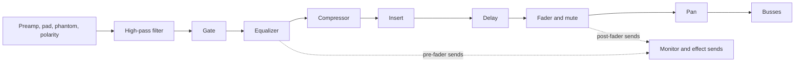
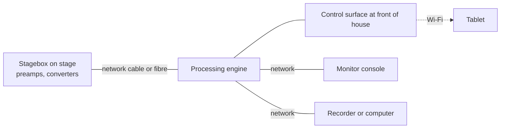

# 11. Mixing consoles

> **Draft, pass 1.** This chapter was written from general knowledge and checked against reference literature for
> coverage. Standards, editions and figures are named but have not yet been verified against their sources. The
> list *To verify in pass 2* at the end names every claim that still needs one.

This chapter answers what a mixing console does with its inputs, how its channels, busses and outputs are organised,
how a digital console with a stagebox differs from an analog desk, how one set of microphones feeds several
consoles, and where the front-of-house console belongs. Gain structure is in
[chapter 4](04-dynamic-range-gain-structure.md), microphone preamplifiers and DI boxes are in
[chapter 9](09-sources.md), and monitor mixing is in chapter 18.

## What a console does

A console takes many inputs, adjusts each one in level, tone and dynamics, and combines them into a smaller number of
mixes. The same inputs usually feed several mixes at once. The main mix for the audience, a monitor mix for each
performer, a recording or a stream, and a feed for a broadcaster all want different balances of the same sources.

Consoles used to be distinguished by the mix they make, such as house, monitor, recording and broadcast consoles.
The distinction remains in how the console is used, but a digital console of moderate size can make all of these
mixes at once, and at small events one console and one engineer often do.

## The channel strip

Each input passes through a chain of processing in a fixed order. The order matters, because a change early in the
chain affects everything after it. A typical modern channel looks like this.

- **Preamp section.** Gain, pad, phantom power and a polarity switch, followed by the converter in a digital console.
  The gain is set here and nowhere else, as chapter 4 explains.
- **High-pass filter.** Removes rumble, handling noise and proximity effect below the source's range. It is the most
  useful single control on a vocal channel.
- **Gate and compressor.** Dynamics processing per channel, which chapter 12 covers. On many digital consoles the
  order of gate, equalizer and compressor can be changed.
- **Insert.** A send and return point for external processing.
- **Delay.** Aligns a source in time with others, for example a close microphone on a guitar amplifier with the
  microphones further away, or a source on stage with its own direct sound in the hall.
- **Fader, mute and pan.** The fader sets the channel's contribution to the main mix, and the pan places it between
  left and right.

### Sends

Sends feed the auxiliary busses that make monitor mixes and effect returns. A pre-fader send takes the signal before
the fader, so a monitor mix does not change when the engineer moves the channel fader for the audience. A post-fader
send follows the fader, which is right for reverb and other effects that should keep their proportion to the dry
signal. On most consoles each send can be switched between the two, and the tap point of the pre-fader send can be set
before or after the equalizer and dynamics.

### Panning

Pan places a mono source between two outputs. A pan pot that only turned one side down would make a centred source
louder in the room than a source panned hard to one side, because both loudspeakers would play it at full level. The
pan law reduces both sides at the centre to compensate.

| Pan law at the centre | Level of a centred source in a mono sum, relative to a hard-panned one |
|---|---|
| −3 dB | +3.0 dB |
| −4.5 dB | +1.5 dB |
| −6 dB | 0 dB |

A −3 dB law keeps the acoustic power constant across the stereo field, which suits a room where both loudspeakers are
heard. A −6 dB law keeps the electrical sum constant, which suits a mono sum or a broadcast. Many consoles use −3 dB,
some allow a choice. In a live system that covers most of the audience from one side, the pan law matters less than
the coverage, and many engineers mix vocals and bass in mono and use the stereo field only for effects.

## Busses, groups, matrices and DCAs

The outputs of the channels are combined on busses. A console offers several kinds.

| Bus | What it carries | Typical use |
|---|---|---|
| Main or master | The main mix, left and right, often with a mono or centre bus | The PA |
| Aux | Individual mixes from the sends | Monitors, effects, recording feeds |
| Group or subgroup | A summed group of channels, with its own processing and fader | Drums, vocals, a choir, compressed together |
| Matrix | Mixes of busses rather than channels | Delay loudspeakers, front fills, broadcast and recording feeds, each with its own level and delay |
| DCA or VCA | No audio, only control | One fader that moves the level of several channels without summing them |

A DCA (digitally controlled amplifier) group, the successor of the VCA groups of analog consoles, lets one fader ride
a set of channels while each keeps its own sends, processing and routing. It is the usual way to give an engineer
eight faders for the whole show.

The noise of a summed bus rises with the number of channels routed to it, by $10 \lg N$ when their noise is
independent. Sixteen channels add 12 dB and 48 channels 16.8 dB to the noise of one. Analog consoles therefore offered
switches to unassign unused channels, and what is not used is not routed. In a digital console
the summing is noiseless, and only the analog inputs contribute.

## Meters

Analog consoles showed levels on a VU meter, which reads an average, or a peak meter. A digital console replaces
both with a meter in dBFS that shows the sample peak and often a slower average, and it adds a gain reduction meter for
every dynamics processor. Two more meters have become common. A true-peak meter shows the level between the samples,
which matters at the output to a converter or a stream, and a loudness meter in LUFS shows the perceived loudness of a
mix, which broadcasters and streaming platforms specify. Chapter 3 explains all three.

## Digital consoles and stageboxes

The largest change in recent decades is that the console no longer processes analog audio. A digital console
consists of a control surface, a processing engine and input and output units, which may be in one box or spread
out.

The stagebox sits on the stage with the microphone preamplifiers and converters, and a single network or fibre cable
replaces the analog multicore. The preamplifiers are controlled remotely from the console. Chapter 15 covers the
networks.

Features that analog consoles lacked change how a show is run.

- **Scenes and snapshots.** The console stores the complete state, or a chosen part of it, and recalls it at a button
  press, for each song, each act or each scene of a play.
- **Recall safe and scope.** Channels or parameters marked as safe are not changed by a scene recall, so that a
  scene for a song does not reset the preamplifier gain or the main equalization.
- **Remote control.** A tablet controls the console over Wi-Fi, which lets the engineer walk the room or stand at the
  monitor position, and lets performers set their own monitor mixes.
- **Virtual sound check.** The console records every input to a computer over the network, and plays the recording
  back through the channels later, so the mix can be refined without the band.
- **Latency compensation.** Each path through a digital console takes a little time, and an insert or a plug-in
  adds more. The console delays the other paths to match, so that sources that are mixed together stay aligned.
  Typical latency from analog input to analog output is 1 to 3 ms, which chapter 15 discusses together with networks.

### Choosing a console's size

Counting inputs, mixes and outputs is the first step in choosing a console. A
practical count includes every microphone and DI on the input list, the returns from effects and playback, a few
spares, and every monitor mix, matrix output and recording feed. Digital consoles often have more mixing channels than
local inputs, and the stagebox decides how many sources can be connected.

## Balancing with transformers or electronic inputs

A balanced input can use a transformer or an electronic differential amplifier. Both reject the noise that is common
to the two wires of a balanced line. The arguments are now mostly settled.

- **Electronic inputs** are cheap, small, flat in frequency and free of the low-frequency saturation of a small
  transformer. They are standard on every console and stagebox.
- **Transformers** provide galvanic isolation, which breaks ground loops and protects against fault voltages between
  two systems, and they have a high common-mode rejection that does not depend on the balance of the source. They are
  used where isolation matters, in splitters, DI boxes and broadcast feeds.

Transformers have one safety advantage. A transformer between two systems that are fed from different mains supplies
prevents a fault current from flowing along the audio cable. Chapter 17 covers earthing and electrical safety.

## Splitting microphone signals

When several consoles need the same microphones, typically front of house, monitors and a recording or broadcast,
the signals are split. Four methods are in use.

| Method | How it works | Strengths | Weaknesses |
|---|---|---|---|
| Y-split (direct) | Parallel wiring of the inputs | Cheap | Phantom power and ground from both consoles, hum, risk |
| Transformer split | A transformer with one primary and two or three secondaries | Isolation, no power needed | Weight, cost, each extra secondary slightly loads the microphone |
| Active split | A splitter amplifier with several isolated outputs | Many outputs, gain for long lines | Needs power, adds noise and a point of failure |
| Digital split | One stagebox feeds several consoles over a network | No extra hardware, any number of consoles | One console must own the preamp gain, or gain compensation is needed |

With a transformer split, the direct output goes to the console that supplies phantom power, usually monitors, and the
isolated outputs go to the others, whose phantom power is switched off. With a digital split, the console that owns
the preamplifier gain changes the level for everyone. Gain compensation, or a fixed gain agreed before the show, keeps
one engineer's change from upsetting the other's mix, which chapter 4 explains in
[Split systems and gain sharing](04-dynamic-range-gain-structure.md#split-systems-and-gain-sharing).

## Sub-mixers, feeds and cascades

A sub-mixer combines a group of sources, such as a keyboard rig or a drum kit, and sends a few outputs to the main
console. Each stage should take part of any level reduction needed, so that faders keep a useful
range of travel and nothing runs at a level where its noise dominates. In a digital system, the same idea applies to
cascading two consoles over a network, and to playback computers that send a stereo mix.

Feeds in the other direction also need care. A broadcaster or a stream needs a mix that is balanced differently from
the room, because the room adds the acoustic sound of the drums and amplifiers that the PA leaves out. A separate
matrix or aux with its own processing and a loudness meter is the usual source. A mix-minus feed sends a remote
participant everything except their own voice, so that they do not hear themselves with a delay, which matters for
remote guests and for hybrid events.

## Where the consoles go

### Front of house

The engineer mixes what they hear. The house console therefore belongs where the sound represents what most of
the audience hears. In practice this means the following.

- **In the audience, on the axis of the system.** Between the left and right systems, at about two thirds of the depth
  of the audience. Off-centre positions shift the image and the balance between the sides.
- **Not under a balcony, not at the back wall and not in a booth.** Under a balcony, the high frequencies of the main
  system are shadowed. At the back wall, the reflection adds bass. In a booth with a window, the engineer hears the
  booth.
- **Not too far.** At 30 m the sound of the stage arrives about 87 ms after it is played, and at 40 m about 117 ms,
  which makes it harder to cue and to judge timing. Much beyond 30 to 35 m, a position closer to the stage with a
  check at the back is preferable.
- **With a clear sight line to the stage** and a cable route that does not cross escape routes or is covered where it
  does.

At events where the production cannot give up a central position, a position off-axis is used with care. The engineer
then walks the room and checks the mix, which a tablet makes easy.

### Monitors

The monitor console sits at the side of the stage, where the engineer can see the performers and their signals and
can hear the wedges at roughly the performers' level. With in-ear monitors, the engineer listens on the same type of
earpiece. Chapter 18 covers monitor mixing.

## To verify in pass 2

- The pan laws used by current consoles and whether −3 dB is the most common default.
- Typical analog-to-analog latency of current digital consoles (1 to 3 ms).
- The recommended maximum distance of front of house from the stage (about 30 to 35 m); check rider practice and
  AES or manufacturer guidance.
- The loading effect of extra secondaries in transformer splitters; check splitter data sheets.
- The term DCA and its relation to VCA groups across manufacturers.

## Sources

- AES67, for network audio between stageboxes, consoles and recorders.
- Davis, G., Jones, R.: *The Sound Reinforcement Handbook*, 2nd ed., Yamaha / Hal Leonard 1989, §11.1 to §11.6
  (pp. 149–171), §11.8 (pp. 175–177), §11.10 (pp. 182–185) and §11.12 (pp. 189–192).
