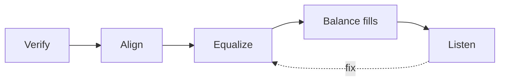

# 20. System design and tuning

> **Draft, pass 1.** This chapter was written from general knowledge and checked against reference literature for
> coverage. Standards, editions and figures are named but have not yet been verified against their sources. The
> list *To verify in pass 2* at the end names every claim that still needs one.

This chapter brings the book together. It answers how a sound system is planned from the requirements of an event,
how its parts are chosen and documented, how its coverage and level are predicted, and how it is tuned on site
until it does what the plan promised. Every section draws on earlier chapters, and links to them where the detail
lives.

## The brief

A system design starts with questions, not with loudspeakers. The answers decide the size, the cost and the
compromises.

- **Programme.** Speech, background music, a band, electronic music or a mix of them. Speech needs intelligibility
  and little bass, and electronic music needs level and deep bass, as chapters 5 and 7 explain.
- **Level.** The target level at the mix position, usually as $L_{Aeq}$ over the show, together with the peak level
  the programme reaches above it.
- **Audience area.** Its shape, the distance from the stage to the nearest and to the farthest listener, and
  whether it is seated, standing, indoors or outdoors.
- **Limits.** Noise limits at the neighbours, audience exposure limits, the venue's rules, the mains supply, the
  rigging points and their loads, and the time for setup.
- **Budget.** Money, crew and transport, which decide how much of the ideal design survives.

The answers are written down. A brief that exists only in a conversation is remembered differently by everyone on
the day of the show.

## Architecture and documentation

From the brief follows the architecture of the system, the chain of [chapter
1](01-signals-and-systems.md#the-signal-chain) from the sources to the loudspeakers, with the number of inputs, the
console and the stage boxes, the processing, the amplifiers, the loudspeaker groups and the monitors.

Three documents describe a system well enough that someone else can build it.

- **A block diagram** that shows the signal flow and the groups, such as left and right tops, subwoofers, front fills
  and delays.
- **A patch list** that names every input and output, from each source on the stage to the amplifier channel and
  the box it drives.
- **A settings table** for each processor and amplifier, with the crossover, delay, equalization, gain and limiter
  of each output.

These documents are best generated from one set of master data, such as a list of the boxes, amplifiers and their
specifications, rather than copied from the last event and edited. Copies drift, and after a few events nobody knows
which copy describes the system as it was set, which the rig documentation of SdWa5 describes from experience (see
*In the SdWa5 rig* below).

## Predicting coverage and level

### Prediction software

Loudspeaker manufacturers supply software that predicts the level and the frequency response of their systems over
a model of the audience area, such as EASE Focus, d&b ArrayCalc, L-Acoustics Soundvision and Meyer Sound MAPP 3D.
For line arrays, this software is the only practical way to choose the number of boxes, the angles between them and
the trim height. For independent comparisons, EASE and similar room acoustics programs model the room as well, using
the directivity data of [chapter 14](14-loudspeakers.md#reading-a-loudspeaker-data-sheet).

A prediction is as good as its model. The software treats the audience as a plane and the air as uniform, and it
knows nothing about the wind, a wrong angle set on site or a box that differs from its data. Its results are checked
by measurement after the setup.

### Coverage

The level across the audience should vary as little as possible. A common target is a variation of a few decibels
from the front to the back. A single point source cannot meet it over a deep audience, because it loses 6 dB per
doubling of distance.

| Audience from | to | Level spread of a point source |
|---|---|---|
| 10 m | 40 m | 12 dB |
| 5 m | 40 m | 18 dB |

The tools against this are those of [chapter 6](06-sound-outdoors.md#covering-the-audience-evenly), which are a line
array that is shaped to aim more energy at the back, a higher position of the main system, which equalizes the
distances, front fills for the first rows that the main system misses, and delay systems for the back.

### Level budget

The required capability of the system follows from the target level, the crest factor of the programme, the distance
and a reserve. For a target of 100 dB $L_{Aeq}$ at the mix position at 30 m, with a programme crest factor of 12 dB
and a reserve of 6 dB, the system must reach the following.

| Step | Value |
|---|---|
| Target level at 30 m | 100 dB |
| Peaks of the programme, +12 dB | 112 dB |
| Distance loss of a point source from 1 m to 30 m | 29.5 dB |
| Reserve against compression and power loss | 6 dB |
| Required peak level at 1 m, as a point source | 147.5 dB |

A single box that reaches 135 dB at 1 m falls 12.5 dB short, which at low frequencies corresponds to about four
coherently coupled boxes, and at high frequencies to a line array whose behaviour the prediction software must
show. Air absorption at high frequencies and over long distances adds further loss, as chapter 6 shows. The same
budget is made for the subwoofers, with the programme's bass content, which for electronic music can be 10 dB above
the rest of the spectrum.

### Fills and delays

A fill system covers an area that the main system misses, and a delay system extends the main system to distant
areas. Both are timed so that their sound arrives just after the sound from the main system, so that the audience
localises the sound at the stage by the precedence effect of [chapter
5](05-hearing.md#localisation-and-the-precedence-effect).

The delay is the distance to the main system divided by the speed of sound, plus a small offset of some
milliseconds. For a delay tower 40 m from the main system the delay is about 117 ms at 20 °C, and with an offset of
10 ms about 127 ms. The speed of sound changes with temperature, as chapter 6 explains, and the delay with it.

| Temperature | Speed of sound | Delay for 40 m |
|---|---|---|
| 0 °C | 331 m/s | 120.7 ms |
| 10 °C | 337 m/s | 118.6 ms |
| 20 °C | 343 m/s | 116.5 ms |
| 30 °C | 349 m/s | 114.6 ms |

A difference of 6 ms between a cold night and a hot afternoon matters for the alignment at high frequencies, so an
outdoor delay is checked by measurement when the temperature has changed. The level of a delay system is set so
that it supports the main system in its area, not so that it dominates it.

### Subwoofers

The subwoofer design follows [chapter 14](14-loudspeakers.md#subwoofer-arrays). A central array or a flown array
gives the most even bass across the audience. Left and right stacks are simpler but produce a power alley and
seat-to-seat differences. A cardioid arrangement keeps the stage quieter and reduces the bass at the neighbours
behind the stage.

## Setting up the processing

The processing of [chapter 12](12-signal-processing.md) is set up in an order that follows the signal.

1. **Load the manufacturer's presets** for the boxes, or the measured settings for self-built boxes, with crossover,
   driver alignment, equalization and limiters.
2. **Set the gain structure** so that the console, the processor and the amplifiers reach their maximum together, as
   [chapter 4](04-dynamic-range-gain-structure.md#matching-the-stages-after-the-console) explains.
3. **Set the limiters** from the power handling of the drivers and the gain of the amplifiers, so that the limiter
   acts before the amplifier clips and before the driver is overloaded, as
   [chapter 13](13-power-amplifiers.md#clipping-and-protection) explains.
4. **Check every output** before the loudspeakers are connected, with a signal that verifies routing and levels.

## Tuning

Tuning turns a system that is set up into one that works in the room. It uses the dual-channel analyzer of
[chapter 16](16-measurement.md#the-dual-channel-fft-analyzer) and the ears, in a fixed order, because each step
depends on the ones before it.

1. **Verify.** Each box and each group is played alone, and its polarity, its frequency response and its level are
   compared with its siblings. A box that differs is wired wrongly, damaged or set wrongly, and it is fixed before
   anything else, because the following steps would otherwise correct a fault with equalization.
2. **Align.** The groups are aligned in time where their sounds overlap. Subwoofers and the main system are aligned
   at their crossover frequency at a representative position, by their phase in the analyzer. At 80 Hz, 1 ms equals
   29° of phase, and a misalignment of 3.1 ms already shifts them by a quarter period, so the alignment is set to a
   fraction of a millisecond. Fills and delays are aligned to the main system in their own areas.
3. **Equalize.** The equalization of each group is set to the average of several measurement positions in its area,
   not to one position, because the response at a single seat is dominated by its local comb filters and room
   modes. The equalization corrects broad tendencies with a few filters, and it does not try to remove narrow notches,
   which move from seat to seat and cannot be filled with level.
4. **Balance fills.** Fills and delays are set to support the main system in their areas, with the main system on,
   until the overall response is even but before the fill becomes the dominant source.
5. **Listen.** Familiar recordings and the engineer's own voice through a microphone at the main positions tell
   whether the measured result sounds right. A system that measures well but sounds wrong has a fault that the
   measurement did not cover, such as distortion, a rattle or an excess of level at the mix position.

A target curve is a choice, not a law. Most engineers tune a system so that it falls gently from the bass to the
treble, because a measured flat response in a room sounds bright, and they set the subwoofers to suit the programme.

### During the show

Once the audience arrives, the room changes, with more absorption, warmer air and the noise of the audience. A
measurement microphone at the mix position with the show's signal as the reference shows how the response moves, and
the engineer corrects the overall equalization and the delays if needed. Noise monitoring against the event's limits,
as chapter 5 describes, runs at the same time.

## In the SdWa5 rig

The rig's [signal chain](../../sdwa5-3d/docs/signal-chain.md) applies the documentation rule of this chapter.
[The table is generated, not copied](../../sdwa5-3d/docs/signal-chain.md#the-table-is-generated-not-copied) explains
why the settings for an event are generated from master data rather than copied from a template, after the copies on
the drive had drifted apart.

[MARK Salzburg, 2026-09-19](../../sdwa5-3d/docs/signal-chain.md#mark-salzburg-2026-09-19) is a worked case of the
whole chapter. The number of outputs that the video mapping rig needed decided the topology, so that a second
processor supplied the missing outputs for the tops. The amplifier gains and limiter thresholds follow from the
gain structure in [Why 32 dB and 26 dB](../../sdwa5-3d/docs/signal-chain.md#why-32-db-and-26-db), and the mains
limits from the phase plan in [Mains](../../sdwa5-3d/docs/signal-chain.md#mains).
[Open, and checked on site](../../sdwa5-3d/docs/signal-chain.md#open-and-checked-on-site) lists what the plan could
not settle, such as the alignment delay of the tops, which still has to account for the latency of the second
processor. It shows the verification step of this chapter in practice, as a list of questions that a measurement
on site answers.

## To verify in pass 2

- Current names and scope of the prediction programs (EASE Focus 3, ArrayCalc, Soundvision, MAPP 3D).
- Typical targets for the level spread across the audience.
- The precedence offset for delay systems (often quoted as 5 ms to 15 ms) and the level limits for it.
- The bass content of electronic music relative to the rest of the spectrum (here assumed about 10 dB).
- Typical target curves for tuning and their slopes.
- Crest factors of typical programme material (12 dB assumed here).

## Sources

- McCarthy, B.: *Sound Systems: Design and Optimization*, Focal Press, 3rd ed. 2016.
- Ahnert, W., Steffen, F.: *Sound Reinforcement Engineering*, Spon 1999.
- Davis, G., Jones, R.: *The Sound Reinforcement Handbook*, 2nd ed., Yamaha / Hal Leonard 1989, §17.1, §17.2
  (pp. 313–324), §18 (pp. 347–370).
- SdWa5: [signal chain](../../sdwa5-3d/docs/signal-chain.md).
